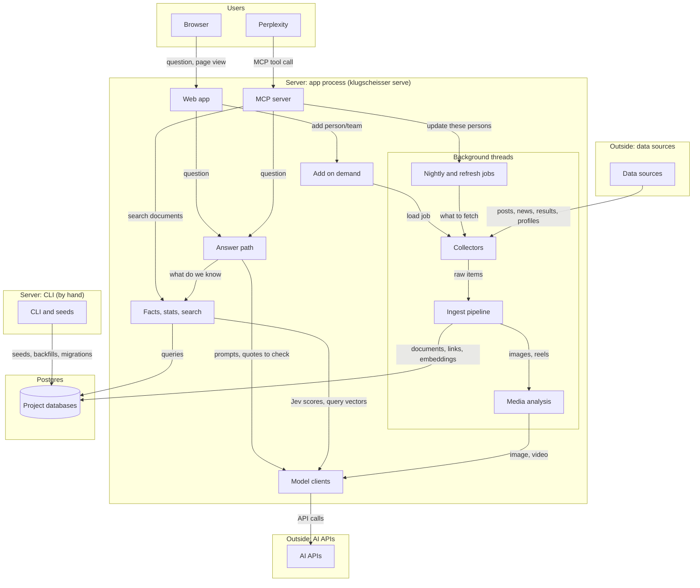

# Architecture

Last updated: 2026-11-24 · branch fix/unihockey-answers: nation X at clubs of country Y (`answer/club_country.py`: "Welche Deutschen spielen in der Schweiz?", club country from league/team/roster, newest club; routed first in `cross.prosa_inputs`, no ask-back), one-off `seed floorball-repair` (`seed/floorball_repair.py`: club countries, research notes hidden as `research_note`, skipped fun facts added in German); before: branch feat/floorball-league-stats: foreign league season stats for floorball players — `collectors/floorball/ssl_se.py` (Swedish SSL regular seasons 2016/17+, public ssl.se JSON API, source `ssl`), `collectors/floorball/fliiga.py` (Finnish F-Liiga 2020/21+, fliiga.com REST player list + player pages, source `fliiga`), shared matching/writing in `collectors/floorball/leagues.py` (name + birth year/nationality/roster club; career stints source `league`; outdated open club stints of web/Wikipedia sources ended when a later federation/league/EP station exists), nightly step `floorball` and one-off CLI `floorball-leagues`; before: 2026-11-24 · branch feat/unihockey-project: third project `unihockey` (men's floorball WCh 2026, database `klugscheisser_unihockey`, no scheduled jobs): sport layer per project (`sports/floorball.py`; `SportSpec.family/team_suffix/men`, `sports.national_team_key()` -> "sui-men"), wording per project (`Wording.player/players/sport_de/…`) in prompts, answers, UI and MCP texts, sport check with the project's home sport (`domain/sport.SportCues`: floorball home, ice hockey "other"), project fields `seeds_dir`/`main_event`/`home_nation` (tiers, tournament files), one-off loader `seed/floorball.py` (`klugscheisser -p unihockey seed floorball`, dry run by default) and free floorball adapters (`collectors/floorball/`: Swiss Unihockey render-engine pages for league stats/careers, Torneopal results-service widgets for the WFC schedule and results, IFF/Wikipedia past WFCs); project field `scheduled_until` (unihockey: nightly + news until 2026-12-14, Swiss date, `Project.scheduled_on`), `SportSpec.nightly_skip` (no IIHF/SIHF/kaderwatch/Hockey Canada/EP/game watch for floorball; nightly step `floorball` instead); before: 2026-11-04 · branch feat/wch-gamewatch: rosters around games (`jobs/game_rosters.py`: after every new/changed final sheet, players who dressed — IIHF scorers/assists/goalies, full line-ups when a feed has them — but are not on the tournament roster are added as `confirmed`, source "IIHF-Spielbericht: <game> (<date>)" + game link; nobody removed, unclear cases logged, game-sheet entries kept when a later official list omits them (`seed/loader.GAME_SHEET_SOURCE`); the follow-up first runs the roster watcher for the two teams (`roster_watch.run(only=…)`); switches `GAME_WATCH_SHEET_ROSTERS`, `GAME_WATCH_ROSTER_WATCH`); game watch (`jobs/gamewatch.py`, thread `game-watch` in `serve`) — polls the IIHF realtime feed of the current IIHF events every `GAME_WATCH_POLL_MINUTES` only from a game's scheduled start until it is final (max `GAME_WATCH_MAX_HOURS`), stores the sheet through the regular results ingest (same advisory lock), re-reads it at `GAME_WATCH_RECHECK_MINUTES` after the final (every poll while incomplete), recounts the national-team tournament totals from the stored sheets (`stats/current.sheet_totals`), and once per game `GAME_WATCH_FOLLOWUP_DELAY_MIN` later runs a follow-up for the two teams (news feeds, team Instagram accounts, roster players not read since the game started) inside the LLM daily cap, the Apify daily/cycle caps and `GAME_WATCH_FOLLOWUP_APIFY_USD`; markers in `cache_entries`, job rows `gamewatch_followup`, CLI `gamewatch --status/--once`; before: 2026-11-01 · branch feat/staff-media-contacts: staff contacts (email/phone) for the WCh teams' media managers / press officers (migration c21c0ffee021, `staff.contacts`); before: branch fix/staff-history-cleanup: career list for persons without Elite Prospects shows one row per station (`web/card_data.py` `_stations`: same team/kind/role with overlapping or ±1 seasons → one row, most precise seasons, all sources as links; EP players unchanged); one-off `staff-fix` (`staff_fix.py`: WCh staff research JSON → end/start dates on `team_staff`, missing staff persons + their stints/stats, wrong old stints → unconfirmed; dry run unless `--yes`); `staff.py` roles `assistant_gm`, Danish læge/fysio; before: 2026-11-01 · branch feat/missed-ep-history: history for players without Elite Prospects data — `stats/history.py` (CLI `history-gaps` audit, read-only; one-off `sihf-history`: past seasons 2014/15+ of SWHL A/B/C from data.sihf.ch `statistic/api/cms/table` per phase → `season_stats` source `sihf` + `career_stints` source `sihf` with seasons, namesake check, idempotent; `ep urls` list for a one-off fetch from the Mac), `stats/ep_ids.py` (CLI `ep-ids`: missing EP ids from Wikidata P2481 / stored links, only solid matches), `ep from-html` (saved player pages → raw files for `ep import --from-dir`), `scripts/ep_mac_fetch.sh`; before: 2026-10-30 · branch feat/instagram-brightdata: Bright Data Web Scraper API as an Instagram source (`collectors/instagram/brightdata.py`, datasets Instagram Posts discover-by-URL + Instagram Profiles; async trigger → progress → snapshot) — hybrid order Graph → Bright Data → Apify for own posts and profiles, mentions Apify only; every part of the hybrid optional (Graph + Bright Data without Apify = no paid source); free-record guard: records per calendar month in `cost_ledger` (source `brightdata`, $0 inside `BRIGHTDATA_FREE_RECORDS_PER_MONTH` 5000), no call past `BRIGHTDATA_MONTHLY_RECORD_CAP` 4500; 401/402/quota errors stop Bright Data for the run and fall back to Apify; smoke test `scripts/brightdata_smoke.py`; before: branch feat/instagram-free-sources: Instagram source `hybrid` (`INSTAGRAM_SOURCE=auto` picks it when Graph and Apify are both set) — own posts and profiles of professional accounts from the free Meta Graph Business Discovery API, all other handles in one batched Apify call, mentions only via Apify; Graph call cap per hour (`META_GRAPH_MAX_CALLS_PER_RUN` 150), rate-limit/token errors fall back to Apify; per-handle hint `graph_ok` in `handles.profile`; Apify budget only for the Apify part; optional cheaper actor `APIFY_INSTAGRAM_ACTOR=apidojo/instagram-scraper` (docs/instagram-sources.md); before: 2026-10-28 · PR #54: official WCh rosters replace camp/provisional lists — kaderwatch (`jobs/roster_watch.py`) with fixed announcement patterns (+ per-team `exclude`, e.g. camp lists), list parsers per federation page (`jobs/roster_parsers.py`: swehockey, JIHF PDF via `pdftotext`, DEB team page, ÖEHV; SIHF as before), the IIHF roster mirror on hockeycanada.ca as fallback for every team, nightly re-read of official lists (late replacements, >6 drops reported not applied), removed entries kept in `source_state` `roster_history` (shown as "nicht im offiziellen Kader" / "gestrichen"), one-off CLI `wch-rosters` (dry run, `--yes`); before: branch feat/german-interview-evidence: German interviews from stored texts — `facts/german_evidence.py` finds German direct quotes of roster persons of other nations (free prefilter), one Claude Sonnet call per (item, person) says whose words and in what setting, the code labels: `bestaetigt` only for an interview/statement to a German-language outlet or German audio/video, club releases, copied quotes and own German posts only `wahrscheinlich`; writes `facts` kind `language_evidence` (cached per pair in `cache_entries` `german_ev`), CLI `german-evidence` (free prefilter without `--yes`), nightly step `deutsch_interviews` (`GERMAN_EVIDENCE_NIGHTLY`, cap `GERMAN_EVIDENCE_MAX_USD` 0.30); before: branch feat/german-club-years: German as interview language — curated club language map `seeds/club_languages.yaml` (Swiss clubs by language region, Ticino = Italian, Romandie = French, Fribourg/Biel/South Tyrol bilingual, German/Austrian leagues = German, HK Budapest not German), German-speaking club years per person from season stats, career stints and affiliations (`facts/german.py`), labels bestätigt (only `facts` kind `language_evidence`, step 2) / wahrscheinlich (with reason) / kein Hinweis on MCP `person`, `team` (Deutsch column, staff too) and `suche` ('Wer spricht Deutsch bei …'), switch `GERMAN_HINTS`; before: branch feat/free-profile-sources: free profile sources for the WCh field — Hockey Canada tournament rosters (height, weight, shoots, birth date, number/club for WCh 2026; nightly step `hockeycanada` until the WCh is over), Wikipedia infobox facts, Wikidata weight + Commons photos in one batch, all ranked below Elite Prospects with conflicts (`facts/source_facts.py`), CLI `free-profiles`; before: branch feat/search-group-stories (on origin/main 7ce2496): story groups at query time — MCP `suche`/`search` fold documents of the same story into one card with an 'Auch berichtet von … – dokument(ids)' line (`SEARCH_GROUP_STORIES`, on; chat `CHAT_GROUP_STORIES`, off), `retrieval/stories.py`; before: branch feat/ep-wch-nightly: Elite Prospects fetch right after the 05:00 refresh (window 05–09), `EP_SCOPE=event:<key>` reads only one event's rosters (WCh 2026); before: fix/full-wikipedia: Wikipedia profiles stored whole (safety limit `PROFILES_WIKIPEDIA_MAX_CHARS` 100k, was 6,000), backfill `profiles-fulltext`, `dokument` parts of 10k; before: feat/search-names (on origin/main 763a94e): MCP `search`/`suche` recognise person names in the question text (`SEARCH_NAMES`); before: Phase F (feat/phase-f-tools): Phase F tool set for Perplexity behind `MCP_NEW_TOOLS` (suche, person, team, events, stats, dokument; maintenance tools hidden); before: search lab (passage vectors, Jev card text + reader context, MCP cards + `dokument`, no-wait person update); before: branch feat/season-totals: current season totals in `season_stats` (nightly step `saisonwerte`, `stats/current.py`: SIHF league tables, national-team totals counted from stored Leijonat/IIHF/Wikipedia sheets), read rule `prefer_current` (current rows win over the EP import unless they lack games played; no double counting); before: branch feat/search-group-stories (on origin/main 7ce2496): story groups at query time — MCP `suche`/`search` fold documents of the same story into one card with an 'Auch berichtet von … – dokument(ids)' line (`SEARCH_GROUP_STORIES`, on; chat `CHAT_GROUP_STORIES`, off), `retrieval/stories.py`; before: branch feat/ep-wch-nightly: Elite Prospects fetch right after the 05:00 refresh (window 05–09), `EP_SCOPE=event:<key>` reads only one event's rosters (WCh 2026); before: fix/full-wikipedia: Wikipedia profiles stored whole (safety limit `PROFILES_WIKIPEDIA_MAX_CHARS` 100k, was 6,000), backfill `profiles-fulltext`, `dokument` parts of 10k; before: feat/search-names (on origin/main 763a94e): MCP `search`/`suche` recognise person names in the question text (`SEARCH_NAMES`); before: Phase F (feat/phase-f-tools): Phase F tool set for Perplexity behind `MCP_NEW_TOOLS` (suche, person, team, events, stats, dokument; maintenance tools hidden); before: search lab (passage vectors, Jev card text + reader context, MCP cards + `dokument`, no-wait person update) · PR #53: 2026-10-28 · branch feat/team-key-players: MCP `team` (Phase F) for a national team other than Switzerland starts with a model-free block "Schlüsselspielerinnen aus Schweizer Sicht" (`mcp_server/key_players.py`: goals/assists of the roster in the stored games against Switzerland from the official sheets' `raw.goals`, Swiss clubs from `facts/german.club_years` + Deutsch label, season top scorers, recent awards, Vorsicht notes), switch `TEAM_KEY_PLAYERS` (default on); before: 2026-10-25 · branch feat/german-interview-evidence: German interviews from stored texts — `facts/german_evidence.py` finds German direct quotes of roster persons of other nations (free prefilter), one Claude Sonnet call per (item, person) says whose words and in what setting, the code labels: `bestaetigt` only for an interview/statement to a German-language outlet or German audio/video, club releases, copied quotes and own German posts only `wahrscheinlich`; writes `facts` kind `language_evidence` (cached per pair in `cache_entries` `german_ev`), CLI `german-evidence` (free prefilter without `--yes`), nightly step `deutsch_interviews` (`GERMAN_EVIDENCE_NIGHTLY`, cap `GERMAN_EVIDENCE_MAX_USD` 0.30); before: branch feat/german-club-years: German as interview language — curated club language map `seeds/club_languages.yaml` (Swiss clubs by language region, Ticino = Italian, Romandie = French, Fribourg/Biel/South Tyrol bilingual, German/Austrian leagues = German, HK Budapest not German), German-speaking club years per person from season stats, career stints and affiliations (`facts/german.py`), labels bestätigt (only `facts` kind `language_evidence`, step 2) / wahrscheinlich (with reason) / kein Hinweis on MCP `person`, `team` (Deutsch column, staff too) and `suche` ('Wer spricht Deutsch bei …'), switch `GERMAN_HINTS`; before: branch feat/free-profile-sources: free profile sources for the WCh field — Hockey Canada tournament rosters (height, weight, shoots, birth date, number/club for WCh 2026; nightly step `hockeycanada` until the WCh is over), Wikipedia infobox facts, Wikidata weight + Commons photos in one batch, all ranked below Elite Prospects with conflicts (`facts/source_facts.py`), CLI `free-profiles`; before: branch feat/search-group-stories (on origin/main 7ce2496): story groups at query time — MCP `suche`/`search` fold documents of the same story into one card with an 'Auch berichtet von … – dokument(ids)' line (`SEARCH_GROUP_STORIES`, on; chat `CHAT_GROUP_STORIES`, off), `retrieval/stories.py`; before: branch feat/ep-wch-nightly: Elite Prospects fetch right after the 05:00 refresh (window 05–09), `EP_SCOPE=event:<key>` reads only one event's rosters (WCh 2026); before: fix/full-wikipedia: Wikipedia profiles stored whole (safety limit `PROFILES_WIKIPEDIA_MAX_CHARS` 100k, was 6,000), backfill `profiles-fulltext`, `dokument` parts of 10k; before: feat/search-names (on origin/main 763a94e): MCP `search`/`suche` recognise person names in the question text (`SEARCH_NAMES`); before: Phase F (feat/phase-f-tools): Phase F tool set for Perplexity behind `MCP_NEW_TOOLS` (suche, person, team, events, stats, dokument; maintenance tools hidden); before: search lab (passage vectors, Jev card text + reader context, MCP cards + `dokument`, no-wait person update); before: branch feat/season-totals: current season totals in `season_stats` (nightly step `saisonwerte`, `stats/current.py`: SIHF league tables, national-team totals counted from stored Leijonat/IIHF/Wikipedia sheets), read rule `prefer_current` (current rows win over the EP import unless they lack games played; no double counting); before: branch feat/search-group-stories (on origin/main 7ce2496): story groups at query time — MCP `suche`/`search` fold documents of the same story into one card with an 'Auch berichtet von … – dokument(ids)' line (`SEARCH_GROUP_STORIES`, on; chat `CHAT_GROUP_STORIES`, off), `retrieval/stories.py`; before: branch feat/ep-wch-nightly: Elite Prospects fetch right after the 05:00 refresh (window 05–09), `EP_SCOPE=event:<key>` reads only one event's rosters (WCh 2026); before: fix/full-wikipedia: Wikipedia profiles stored whole (safety limit `PROFILES_WIKIPEDIA_MAX_CHARS` 100k, was 6,000), backfill `profiles-fulltext`, `dokument` parts of 10k; before: feat/search-names (on origin/main 763a94e): MCP `search`/`suche` recognise person names in the question text (`SEARCH_NAMES`); before: Phase F (feat/phase-f-tools): Phase F tool set for Perplexity behind `MCP_NEW_TOOLS` (suche, person, team, events, stats, dokument; maintenance tools hidden); before: search lab (passage vectors, Jev card text + reader context, MCP cards + `dokument`, no-wait person update) · PR #55: 2026-10-28 · branch feat/league-season-totals: club league tables of other countries in the nightly `saisonwerte` step — SDHL/NDHL (`collectors/results/swehockey_stats.py`, source `swehockey`), Auroraliiga (`collectors/results/leijonat_stats.py`, `leijonat_liiga`), Japan league counted from JIHF game sheets (`collectors/results/jihf_stats.py`, `jihf`, finished sheets kept in `source_state`), each with a switch and a match check (`stats/current.plausible`: position, birth year, other league this season → not stored); one-off `youth-backfill` (`stats/youth.py`: U18 WCh 2017–2026 from Leijonat level 134, source `leijonat_u18`, only where EP has no row); before: branch feat/german-interview-evidence: German interviews from stored texts — `facts/german_evidence.py` finds German direct quotes of roster persons of other nations (free prefilter), one Claude Sonnet call per (item, person) says whose words and in what setting, the code labels: `bestaetigt` only for an interview/statement to a German-language outlet or German audio/video, club releases, copied quotes and own German posts only `wahrscheinlich`; writes `facts` kind `language_evidence` (cached per pair in `cache_entries` `german_ev`), CLI `german-evidence` (free prefilter without `--yes`), nightly step `deutsch_interviews` (`GERMAN_EVIDENCE_NIGHTLY`, cap `GERMAN_EVIDENCE_MAX_USD` 0.30); before: branch feat/german-club-years: German as interview language — curated club language map `seeds/club_languages.yaml` (Swiss clubs by language region, Ticino = Italian, Romandie = French, Fribourg/Biel/South Tyrol bilingual, German/Austrian leagues = German, HK Budapest not German), German-speaking club years per person from season stats, career stints and affiliations (`facts/german.py`), labels bestätigt (only `facts` kind `language_evidence`, step 2) / wahrscheinlich (with reason) / kein Hinweis on MCP `person`, `team` (Deutsch column, staff too) and `suche` ('Wer spricht Deutsch bei …'), switch `GERMAN_HINTS`; before: branch feat/free-profile-sources: free profile sources for the WCh field — Hockey Canada tournament rosters (height, weight, shoots, birth date, number/club for WCh 2026; nightly step `hockeycanada` until the WCh is over), Wikipedia infobox facts, Wikidata weight + Commons photos in one batch, all ranked below Elite Prospects with conflicts (`facts/source_facts.py`), CLI `free-profiles`; before: branch feat/search-group-stories (on origin/main 7ce2496): story groups at query time — MCP `suche`/`search` fold documents of the same story into one card with an 'Auch berichtet von … – dokument(ids)' line (`SEARCH_GROUP_STORIES`, on; chat `CHAT_GROUP_STORIES`, off), `retrieval/stories.py`; before: branch feat/ep-wch-nightly: Elite Prospects fetch right after the 05:00 refresh (window 05–09), `EP_SCOPE=event:<key>` reads only one event's rosters (WCh 2026); before: fix/full-wikipedia: Wikipedia profiles stored whole (safety limit `PROFILES_WIKIPEDIA_MAX_CHARS` 100k, was 6,000), backfill `profiles-fulltext`, `dokument` parts of 10k; before: feat/search-names (on origin/main 763a94e): MCP `search`/`suche` recognise person names in the question text (`SEARCH_NAMES`); before: Phase F (feat/phase-f-tools): Phase F tool set for Perplexity behind `MCP_NEW_TOOLS` (suche, person, team, events, stats, dokument; maintenance tools hidden); before: search lab (passage vectors, Jev card text + reader context, MCP cards + `dokument`, no-wait person update); before: branch feat/season-totals: current season totals in `season_stats` (nightly step `saisonwerte`, `stats/current.py`: SIHF league tables, national-team totals counted from stored Leijonat/IIHF/Wikipedia sheets), read rule `prefer_current` (current rows win over the EP import unless they lack games played; no double counting); before: branch feat/search-group-stories (on origin/main 7ce2496): story groups at query time — MCP `suche`/`search` fold documents of the same story into one card with an 'Auch berichtet von … – dokument(ids)' line (`SEARCH_GROUP_STORIES`, on; chat `CHAT_GROUP_STORIES`, off), `retrieval/stories.py`; before: branch feat/ep-wch-nightly: Elite Prospects fetch right after the 05:00 refresh (window 05–09), `EP_SCOPE=event:<key>` reads only one event's rosters (WCh 2026); before: fix/full-wikipedia: Wikipedia profiles stored whole (safety limit `PROFILES_WIKIPEDIA_MAX_CHARS` 100k, was 6,000), backfill `profiles-fulltext`, `dokument` parts of 10k; before: feat/search-names (on origin/main 763a94e): MCP `search`/`suche` recognise person names in the question text (`SEARCH_NAMES`); before: Phase F (feat/phase-f-tools): Phase F tool set for Perplexity behind `MCP_NEW_TOOLS` (suche, person, team, events, stats, dokument; maintenance tools hidden); before: search lab (passage vectors, Jev card text + reader context, MCP cards + `dokument`, no-wait person update)

## Overview

Klugscheisser Karl collects news, social posts, game results, profiles and stats about athletes (mainly Swiss
women's ice hockey) into one Postgres database per project, and answers questions from that stored data, every
statement with a source link and a verbatim quote. One Python process (`klugscheisser serve`) serves both a German
web app (search, person/team/event pages, chat) for the browser and an MCP server for Perplexity, and runs the
background work (nightly refresh, news poller, image analysis) as threads. The `klugscheisser` CLI is used by hand
for seeding, backfills, migrations, backups and evaluations.

## Where it runs

- **Server**: Ondrej's netcup VPS (Debian). Live code is the checkout `~/klugscheisser`; development happens in
  `~/projects/klugscheisser_athlete` and its worktrees (docs/server-handoff.md, "As built").
- **One app process**: the systemd system unit `klugscheisser.service` (unit file outside the repo) runs
  `klugscheisser serve` as user `ondrej`. It is uvicorn on `MCP_HOST:MCP_PORT` (default `127.0.0.1:8000`), built in
  [src/klugscheisser/mcp_server/server.py](src/klugscheisser/mcp_server/server.py) (`build_app`, `serve`).
  Web pages live under `/p/<project>/`, MCP under `/mcp/<project>`, plus `/healthz`.
- **Caddy** (outside the repo, `/etc/caddy/Caddyfile`) takes HTTPS on ports 80/443 for
  `karl.example.org` and forwards to the app on localhost. The app trusts forwarded headers only from
  127.0.0.1.
- **Threads inside the app process** (started by `serve`): `nightly-refresh` (wakes every 10 min, runs once per
  night after `NIGHTLY_HOUR`, 05:00 Swiss time), `news-poller` (every `NEWS_POLL_MINUTES`), `game-watch` (looks at
  the database every minute; asks IIHF only while a game runs and shortly after it), `media-worker`
  (image/reel queue), and short-lived job threads for on-demand updates and adds
  ([src/klugscheisser/projects.py](src/klugscheisser/projects.py) `ContextPool`). The nightly refresh is a thread
  inside `serve`, not a cron job or systemd timer: if the service is down at 05:00, it runs when it is back.
- **CLI processes**: `uv run klugscheisser …` started by hand ([src/klugscheisser/cli.py](src/klugscheisser/cli.py));
  same code, same databases, ends when done.
- **Libraries, not processes**: `answer`, `knowledge`, `adds`, `collectors`, `ingest`, `models` are Python
  packages called inside the app process (or a CLI run).
- **Postgres 17 + pgvector** on the same server, local socket, one database per project
  ([projects.yaml](projects.yaml)): `klugscheisser` (project `eishockey`, nightly on), `klugscheisser_allgemein`
  (project `allgemein`, no scheduled jobs) and `klugscheisser_unihockey` (project `unihockey`, men's floorball,
  scheduled jobs until 2026-12-14; seeds `seeds/floorball`). Nightly `pg_dump` backups go to `backups/`. Dev only:
  `klugscheisser_test` (tests), `klugscheisser_loop` (gap-loop copy, port 8020), `klugscheisser_preview` (UI loop).
- **Outside services** are called over HTTPS from the app process: data sources and AI APIs (see External
  dependencies). `docker-compose.yml` is a local Postgres for the Mac only.

## Components

| Component | Responsibility | Runs where | Key files | Depends on |
|---|---|---|---|---|
| `browser` Browser | Fabi's (and Ondrej's) browser: search, person/team/event pages, chat | User's device, HTTPS via Caddy | — | web |
| `perplexity` Perplexity | Perplexity connector "Klugscheisser Karl" calls Karl's MCP tools and writes the final reply | Perplexity's cloud | [docs/perplexity.md](docs/perplexity.md) | mcp |
| `web` Web app | German web UI, server-rendered with htmx: search, pages, chat with follow-ups, ratings, project page; login by Cloudflare Access email or password; picks the project from `/p/<key>` | App process (request handling) | [src/klugscheisser/web/](src/klugscheisser/web/), [src/klugscheisser/chat/](src/klugscheisser/chat/), [src/klugscheisser/web/routes.py](src/klugscheisser/web/routes.py), [src/klugscheisser/web/access.py](src/klugscheisser/web/access.py), [src/klugscheisser/web/project_switch.py](src/klugscheisser/web/project_switch.py) | answer, knowledge, adds, jobs |
| `mcp` MCP server | MCP tools for Perplexity (`frage`, `get_athlete`, `stats`, `search`, `list_events`, `get_event`, `whats_new`, `refresh`, `hinzufuegen` …): compact German text, size cap, bearer token; also builds the app and starts the threads | App process (request handling) | [src/klugscheisser/mcp_server/](src/klugscheisser/mcp_server/), [src/klugscheisser/mcp_server/server.py](src/klugscheisser/mcp_server/server.py), [src/klugscheisser/mcp_server/tools.py](src/klugscheisser/mcp_server/tools.py), [src/klugscheisser/mcp_server/present.py](src/klugscheisser/mcp_server/present.py), [src/klugscheisser/mcp_server/key_players.py](src/klugscheisser/mcp_server/key_players.py) | answer, knowledge, adds, jobs |
| `adds` Add on demand | Add a person, team or event: proposal with cost estimate, confirm, then a background load job | App process (library + job thread) | [src/klugscheisser/adds/](src/klugscheisser/adds/), [src/klugscheisser/adds/flow.py](src/klugscheisser/adds/flow.py), [src/klugscheisser/adds/load.py](src/klugscheisser/adds/load.py) | collectors, ingest |
| `answer` Answer path | Turns a question into a checked answer: interpreter, direct lookups or cross-person blocks or documents, the model writes cited sentences, each quote checked (verbatim + Jev support), optional agent round; answer cache, per-answer and daily spend caps | App process (library) | [src/klugscheisser/answer/](src/klugscheisser/answer/), [src/klugscheisser/answer/engine.py](src/klugscheisser/answer/engine.py), [src/klugscheisser/answer/cross.py](src/klugscheisser/answer/cross.py), [src/klugscheisser/answer/club_country.py](src/klugscheisser/answer/club_country.py), [src/klugscheisser/llm/budget.py](src/klugscheisser/llm/budget.py), [src/klugscheisser/briefing.py](src/klugscheisser/briefing.py) | knowledge, models, jobs |
| `knowledge` Facts, stats, search | Read side of the stored data: the one document-finding path for chat, agent and MCP `search` (candidates from full text, pgvector, Jev labels, the persons' documents; Jev scores them), sourced facts (and their extraction), season stats, staff, tournaments, current person status, tiers, German as interview language (club language map) | App process (library) | [src/klugscheisser/retrieval/](src/klugscheisser/retrieval/), [src/klugscheisser/facts/](src/klugscheisser/facts/), [src/klugscheisser/stats/](src/klugscheisser/stats/), [src/klugscheisser/tournament.py](src/klugscheisser/tournament.py), [src/klugscheisser/staff.py](src/klugscheisser/staff.py), [src/klugscheisser/person_status.py](src/klugscheisser/person_status.py), [src/klugscheisser/tiers.py](src/klugscheisser/tiers.py) | db, models |
| `models` Model clients | The only place that talks to AI APIs: text/JSON (Claude Sonnet or Gemini), Jev classifier/reranker, embeddings, translations, name pronunciation | App process (library) | [src/klugscheisser/llm/](src/klugscheisser/llm/), [src/klugscheisser/llm/text.py](src/klugscheisser/llm/text.py), [src/klugscheisser/classify/jev.py](src/klugscheisser/classify/jev.py), [src/klugscheisser/embed/providers.py](src/klugscheisser/embed/providers.py), [src/klugscheisser/translate.py](src/klugscheisser/translate.py), [src/klugscheisser/pronounce.py](src/klugscheisser/pronounce.py) | aiapis |
| `jobs` Nightly and refresh jobs | Nightly refresh (who, what, cost caps; results, then current season totals; then Elite Prospects and backup), 30-min news poller, game watch (IIHF games right after the final + follow-up per game), once-a-day update of asked persons, deep backfill ("Alles neu laden"), job status | App process (threads) | [src/klugscheisser/jobs/](src/klugscheisser/jobs/), [src/klugscheisser/jobs/nightly.py](src/klugscheisser/jobs/nightly.py), [src/klugscheisser/jobs/freshness.py](src/klugscheisser/jobs/freshness.py), [src/klugscheisser/jobs/refresh.py](src/klugscheisser/jobs/refresh.py), [src/klugscheisser/deep.py](src/klugscheisser/deep.py), [src/klugscheisser/projects_admin.py](src/klugscheisser/projects_admin.py) | collectors, ingest, db |
| `collectors` Collectors | Fetch from outside: Instagram, Facebook, X, news feeds, results (SIHF, IIHF, PWHL, SDHL, Leijonat, Wikipedia), Wikipedia/college bios, Wikidata, Hockey Canada tournament rosters, Elite Prospects, Brave web search | App process (library, used by threads) | [src/klugscheisser/collectors/](src/klugscheisser/collectors/), [src/klugscheisser/collectors/results/](src/klugscheisser/collectors/results/), [src/klugscheisser/web_search/](src/klugscheisser/web_search/), [src/klugscheisser/interfaces.py](src/klugscheisser/interfaces.py) | sources, ingest |
| `ingest` Ingest pipeline | Store each item once: dedup, link to persons/teams (name matcher, verified handles), classify (rules, then Jev, then LLM fallback), embed, queue images; cost ledger | App process (library, used by threads) | [src/klugscheisser/ingest/](src/klugscheisser/ingest/), [src/klugscheisser/ingest/store.py](src/klugscheisser/ingest/store.py), [src/klugscheisser/classify/](src/klugscheisser/classify/), [src/klugscheisser/domain/](src/klugscheisser/domain/), [src/klugscheisser/handles/](src/klugscheisser/handles/), [src/klugscheisser/ep_import.py](src/klugscheisser/ep_import.py) | db, models, media |
| `media` Media analysis | Queue worker that describes Instagram images and reels in text (media bytes only in memory, never stored) and saves the description | App process (thread) | [src/klugscheisser/media/](src/klugscheisser/media/), [src/klugscheisser/media/worker.py](src/klugscheisser/media/worker.py), [src/klugscheisser/media/analyzer.py](src/klugscheisser/media/analyzer.py) | models, db |
| `cli` CLI and seeds | `klugscheisser` command: serve, seed (curated YAML + Wikidata), ingest, nightly by hand, backfills, project create/migrate/backup, chat-eval, chat-replay | Server, by hand (separate process) | [src/klugscheisser/cli.py](src/klugscheisser/cli.py), [src/klugscheisser/seed/](src/klugscheisser/seed/), [seeds/](seeds/), [src/klugscheisser/sports/](src/klugscheisser/sports/), [src/klugscheisser/chat_eval.py](src/klugscheisser/chat_eval.py), [src/klugscheisser/replay.py](src/klugscheisser/replay.py) | db, jobs, collectors, answer |
| `db` Project databases | Postgres + pgvector, one database per project; documents, persons, teams, events, facts, stats, chats, jobs, cost ledger; schema by Alembic | Postgres on the server (local socket) | [src/klugscheisser/db/](src/klugscheisser/db/), [src/klugscheisser/db/models.py](src/klugscheisser/db/models.py), [migrations/](migrations/), [projects.yaml](projects.yaml), [src/klugscheisser/projects.py](src/klugscheisser/projects.py) | — |
| `sources` Data sources | Instagram (Meta Graph Business Discovery + Bright Data + Apify), Facebook, X API, news RSS, federation and league result feeds, Wikipedia, Wikidata, college sites, Elite Prospects, Brave Search | Internet | [src/klugscheisser/sources_registry.py](src/klugscheisser/sources_registry.py), [docs/sources.md](docs/sources.md), [seeds/feeds.yaml](seeds/feeds.yaml) | — |
| `aiapis` AI APIs | Anthropic (Claude Sonnet), Google Gemini (fallback text, embeddings, TTS, images/reels), TypeSafe Jev | Internet | [src/klugscheisser/config.py](src/klugscheisser/config.py) | — |

Almost every component reads or writes the database; the diagram shows only the main data flows. Smaller code
links (for example `jobs/refresh.py` and `answer/engine.py` reusing helpers from `mcp_server/`) are only in
"Depends on".

## Services & what they're for

Every outside service and infrastructure piece, what Karl uses it for, what it costs and which setting turns it
on or limits it. Settings are env var names (values live in the live `.env` or the project settings page).
"live:" marks a live value that differs from the code default (live runs 9aa5717).

| Service | Used for | Paid? / cost guard | Switch / key setting |
|---|---|---|---|
| PostgreSQL 17 + pgvector (same server) | all stored data, one database per project; pgvector holds the 384-dim vectors used as search candidates for chat and MCP `search` (live made by Gemini `gemini-embedding-001`) | free (own server); nightly `pg_dump`, newest 7 per project kept | `DATABASE_URL`, `PROJECTS_FILE` |
| systemd unit `klugscheisser.service` | keeps the one `klugscheisser serve` process running | free | unit file outside the repo |
| Caddy | HTTPS on ports 80/443 for `karl.example.org`, forwards to `127.0.0.1:8000` | free | `/etc/caddy/Caddyfile` (outside the repo) |
| uvicorn + Starlette | HTTP server and routing for web pages, MCP and `/healthz` in one process | free | `MCP_HOST`, `MCP_PORT` |
| MCP Python SDK (Streamable HTTP) | the 16 tools Perplexity calls on `/mcp/<project>` | free | `MCP_AUTH_TOKEN`, `MCP_ALLOWED_HOSTS` |
| htmx 2.0.4 (from unpkg) | partial page updates in the browser (chat answer, "Mehr laden") | free | — |
| Cloudflare Access (optional) | login by email header instead of password | free | `WEB_ACCESS_EMAILS` (used live: (?)) |
| Perplexity | the assistant Fabi asks; calls Karl through the connector "Klugscheisser Karl" | Perplexity account (?) | connector instructions (`docs/perplexity.md`) |
| Anthropic Claude Sonnet 5.5 | all writing: answers, interpreter, agent planning, facts, translations, briefing; classification only when Jev is down | paid per token ($2 / $10 per M in/out); per answer `ANSWER_MAX_USD` 0.08, answers per 24 h `LLM_DAILY_COST_CAP_USD` 2 (live: 5), agent `AGENT_MAX_USD` 0.02 (live: 0.04) | `ANTHROPIC_API_KEY`, `LLM_PROVIDER` auto (live: Claude) |
| Google Gemini | image/reel descriptions (`gemini-3.8-flash` + fallbacks), name pronunciation TTS, embeddings (`gemini-embedding-001` at 384 dims; live: on), writing when `LLM_PROVIDER=gemini` | paid per token; `MEDIA_DAILY_LIMIT` 150 analyses per 24 h; TTS under the daily LLM cap | `GEMINI_API_KEY`, `MEDIA_PROVIDER`, `EMBEDDING_PROVIDER` fake (live: gemini) |
| TypeSafe Jev (`jev-latest`) | classify items, rank documents for answers, check that a quote supports a sentence, "same person?", decide if the agent is needed | paid per token ($0.042 per M); counted in the answer budget and daily cap | `TYPESAFE_API_KEY` |
| Apify `apify/instagram-scraper` (or `apidojo/instagram-scraper`) | Instagram posts of persons and team accounts that Graph and Bright Data cannot read, tagged posts, profiles (bios) | pay per result (~$0.0027 per post); `APIFY_DAILY_COST_CAP_USD` 2, `NIGHTLY_CAP_USD` 2, `APIFY_CYCLE_CAP_USD` 18 of the $19 plan | `APIFY_TOKEN`, `INSTAGRAM_SOURCE` |
| Apify `apify/facebook-posts-scraper` | text of persons' own public Facebook pages (tier 1, deep backfill only) | $0.005 per post + $0.001 per run; inside the deep-run cap | `APIFY_TOKEN` |
| X API v2 (`api.x.com`) | posts of persons' and the federation's X accounts | $0.005 per post, $0.010 per user lookup; `X_DAILY_COST_CAP_USD` 1 | `X_BEARER_TOKEN` |
| Brave Search API | web and news search for adds and deep backfill (answers only with `ANSWER_WEB_SEARCH`, default off) | $0.005 per request; `BRAVE_DAILY_CAP` 100 per 24 h | `BRAVE_API_KEY` |
| News RSS (33 feeds: SRF, Blick, 20 Minuten, Watson, NZZ, RTS …) | news articles; full article only where terms allow (4 feeds) | free | `NEWS_POLL_MINUTES` 30 |
| SIHF (`data.sihf.ch`, sihf.ch national-team pages) | Swiss league results, Swiss national-team results, league season tables (players, goalies) | free | `SIHF_DATA_ENABLED`, `SIHF_NT_ENABLED` |
| IIHF realtime | World Championship games (event 773); during games also the game watch (feed + live game states every 5 min, re-checks after the final) | free | `IIHF_REALTIME_ENABLED`, `IIHF_EVENT_ID`, `GAME_WATCH`, `GAME_WATCH_POLL_MINUTES` |
| PWHL (HockeyTech feed) | PWHL games of the followed teams | free (public site key) | `PWHL_ENABLED` |
| SDHL (`stats.swehockey.se`) | Swedish league games | free | `SDHL_ENABLED` |
| College sites (Sidearm, `seeds/college_sites.yaml`) | NCAA season stats of the colleges with Swiss players (`/stats` page; bios: `profiles`) | free, robots.txt + Crawl-delay 30 s | `SEASON_TOTALS_COLLEGE_ENABLED` |
| Leijonat (`tulospalvelu.leijonat.fi`) | women's national-team games (Euro Hockey Tour …) | free | `LEIJONAT_ENABLED` |
| Wikipedia | bios (up to 4 languages), game boxes for past tournaments | free | `PROFILES_ENABLED` |
| College sites (Sidearm) | college player bios | free (slow Crawl-delay) | `PROFILES_COLLEGE_ENABLED` |
| Federation roster pages + IIHF roster mirror (hockeycanada.ca) | official WCh roster: announcement, list, late replacements ("kaderwatch") | free, ~1–2 pages per team + ~11 mirror pages per night | nightly step, `seeds/events/`, `jobs/roster_parsers.py` |
| Wikidata SPARQL | seed players and their social handles, extra facts (weight P2067 since 2026-10-25) | free | CLI `seed wikidata`, `free-profiles wikidata` |
| Hockey Canada stats site (hockeycanada.ca) | IIHF women's tournament rosters of all teams (WCh 2024–2026, Olympics 2026, U18 WCh 2025/26): height, weight, shoots, birth date, hometown; number + club for WCh 2026 | free, ~11 pages a night until the WCh is over (3 s apart), ~62 for all events by hand | `HOCKEYCANADA_NIGHTLY`, CLI `free-profiles hockeycanada` |
| Wikimedia Commons | recorded name pronunciations (before Gemini TTS); profile photos (Wikidata P18: link + author + licence, never the file) | free | CLI `free-profiles wikidata` (batch), person page (lazy) |
| Elite Prospects | profiles, season stats, career (imported once; nightly for one event's rosters with `EP_SCOPE`) | free, but terms forbid scraping; `EP_DAILY_PAGE_CAP` 300 | `EP_ENABLED` false (live: unset, off) |
| Meta Graph API Business Discovery (optional) | own posts + profiles of public Business/Creator Instagram accounts, first choice in the `hybrid` source | free, ~200 calls/h; `META_GRAPH_MAX_CALLS_PER_RUN` 150 | `META_GRAPH_TOKEN`, `META_IG_BUSINESS_USER_ID`, `META_GRAPH_API_VERSION` (used live: (?)) |
| Bright Data Web Scraper API (optional; `api.brightdata.com/datasets/v3`) | own posts (incl. collaborations) and profiles of any public Instagram account, second choice in the `hybrid` source (after Graph, before Apify); no tagged posts | free tier 5000 records per calendar month (no card: hard stop over it), then $1.50 per 1000; Karl stops at `BRIGHTDATA_MONTHLY_RECORD_CAP` 4500 (ledger source `brightdata`), history loads capped at `BRIGHTDATA_HISTORY_MAX_POSTS` 50 per handle | `BRIGHTDATA_API_TOKEN`, `BRIGHTDATA_TIMEOUT_S` 600 |
| Claude Code CLI (optional) | media analysis on Ondrej's subscription | subscription | `MEDIA_PROVIDER=claude-cli` |
| sentence-transformers (optional) | local embeddings (`intfloat/multilingual-e5-small`) | free | `EMBEDDING_PROVIDER=local` |

## Main flows

### Nightly refresh
1. `jobs`: the nightly thread checks every 10 minutes; once per night after 05:00 Swiss time it recomputes tiers, picks the persons (tier 1 every night, tier 2 one seventh), estimates the cost and skips paid steps over a cap.
2. `collectors` fetch Instagram, X, news, results, roster pages and profiles from `sources`; around the WCh (3 weeks before until the day after) also the Hockey Canada tournament rosters (step `hockeycanada`, facts straight into `db`).
3. `ingest` stores each new item: dedup, link to persons and teams, classify, embed, write to `db`.
4. `media` describes queued images and reels through `models` (Gemini) and saves the text.
5. `jobs` makes a `pg_dump` backup of each project database; the Elite Prospects fetch (only with `EP_ENABLED`) runs right after the refresh, inside its 05–09 window.

### A WCh game day (game watch)
1. `jobs`: the `game-watch` thread looks at the stored schedule every minute; from a game's start it asks `sources` (IIHF realtime) every 5 minutes for the event feed and the live game state.
2. `collectors` + `ingest` store score, scorers, assists, goalies and period scores the same way as the nightly results step; at the final the game sheet becomes a result document in `db`, the national-team tournament totals are recounted.
3. The sheet is read again 10, 30 and 120 minutes after the final (IIHF corrections).
4. About 60 minutes after the final, once per game: first the roster watcher (kaderwatch, free) for the two teams, then news feeds plus Instagram of both teams' accounts and roster players (`collectors` → `ingest`), inside the cost caps; never while a nightly run is going.
5. Every new or changed final sheet: players who dressed but are not on the tournament roster are added from the sheet (`jobs/game_rosters.py`, database only; nobody is removed, unclear names are logged).

### A question in the web chat
1. `browser` sends the question (HTTPS, through Caddy); `web` saves it in the chat and the page asks for the answer.
2. `answer` lets the interpreter (Claude Sonnet via `models`) rewrite the question into a known template.
3. `answer` collects what is stored from `knowledge`: facts, stats, tournaments, staff or the persons' documents in `db`.
4. `answer` has the model write sentences with quotes (`models`), checks every quote (verbatim, Jev support), and may run one agent round.
5. `web` shows the written answer with numbered sources in the `browser`.

### A question via Perplexity (MCP)
1. `perplexity` calls the tool `frage` (or `get_athlete`, `stats`, `list_events` …) on `/mcp/eishockey` with the bearer token.
2. `mcp` asks `jobs` to update the asked persons once per day; with `MCP_REFRESH_NO_WAIT` (default) no tool waits: the update runs in the background and the answer says so next to its Datenstand line (off: person tools wait up to `AUTO_REFRESH_WAIT_S`).
3. `answer` answers in list style from `knowledge` and checked quotes (`models`).
4. `mcp` returns compact German text to `perplexity` (cut at 12,000 characters), which writes the reply for the user.

## External dependencies

**Databases**
- PostgreSQL 17 + pgvector (see "Where it runs"): `db/session.py`, `projects.py`, `migrations/env.py`; backups with `pg_dump`: `projects_admin.py`.

**AI APIs and models**
- Anthropic Claude Sonnet (all text/JSON writing: answers, interpreter, agent, facts, translations): `llm/text.py`, `llm/providers.py`.
- Google Gemini (fallback text model, embeddings, TTS, reel/image analysis): `llm/text.py`, `embed/providers.py`, `pronounce.py`, `media/analyzer.py`.
- Jev by TypeSafe (classification, reranking, quote support, identity): `classify/jev.py`, `identity.py`.
- Claude Code CLI as an optional media analyzer (`MEDIA_PROVIDER=claude-cli`): `media/analyzer.py`.
- Local sentence-transformers model (optional, `EMBEDDING_PROVIDER=local`): `embed/providers.py`.

**Data sources**
- Apify (Instagram scraper, Facebook posts): `collectors/instagram/sources.py`, `collectors/facebook.py`; Meta Graph API (optional): `collectors/instagram/sources.py`; Bright Data (optional): `collectors/instagram/brightdata.py`.
- Official X API v2: `collectors/x_api.py`. xAI Grok x_search is a skeleton, not wired in: `collectors/x_grok.py`.
- Brave Search API + allowed page fetch: `web_search/brave.py`.
- News RSS (SRF, Blick, 20 Minuten, Watson, NZZ; list in `seeds/feeds.yaml`): `collectors/rss.py`.
- Results: SIHF (`data.sihf.ch`, sihf.ch national-team pages), IIHF realtime, PWHL (HockeyTech), SDHL (stats.swehockey.se), Leijonat, Wikipedia game boxes: `collectors/results/`.
- Wikipedia and college (Sidearm) bios: `collectors/profiles/`; Wikidata SPARQL: `collectors/wikidata.py`; Wikimedia Commons audio: `pronounce.py`.
- Elite Prospects pages (off unless `EP_ENABLED`): `collectors/eliteprospects/fetch.py`, imported by `ep_import.py`.
- Federation roster pages (WCh roster watch): `jobs/roster_watch.py` (list formats: `jobs/roster_parsers.py`; fallback: IIHF rosters mirrored on hockeycanada.ca via `collectors/hockeycanada.py`; removed roster entries: `source_state` `roster_history`, `seed/loader.record_removed`; one-off catch-up: CLI `wch-rosters`).

**Scheduled work** (threads inside `serve`, no cron or systemd timers in the code)
- Nightly refresh after `NIGHTLY_HOUR` plus project backup, Elite Prospects fetch in its own window, weekly briefing suggestion: `jobs/nightly.py` (`start_nightly_worker`).
- News poller every `NEWS_POLL_MINUTES`: `jobs/nightly.py` (`start_news_poller`).
- Game watch (IIHF games right after the final, follow-up per game about an hour later): `jobs/gamewatch.py` (`start_game_watch`; status: CLI `gamewatch --status`).
- Media analysis queue: `media/worker.py` (`start_background_worker`).
- Jobs left "running" by a restart are recovered on start: `jobs/refresh.py` (`recover_stale_jobs`).

**Config switches** (env / `.env`, all in `config.py`; projects can override in `projects.yaml` or the settings page)
- `DATABASE_URL`, `PROJECTS_FILE`: database server and project list.
- `MCP_HOST`, `MCP_PORT`, `MCP_AUTH_TOKEN`, `MCP_ALLOWED_HOSTS`: bind address and MCP access (`mcp_server/server.py`, `mcp_server/auth.py`).
- `WEB_ACCESS_EMAILS`, `WEB_PASSWORD`: web login (`web/access.py`).
- `ANTHROPIC_API_KEY`, `GEMINI_API_KEY`, `TYPESAFE_API_KEY`, `APIFY_TOKEN`, `X_BEARER_TOKEN`, `BRAVE_API_KEY`, `META_GRAPH_TOKEN`: each outside service is on only when its key is set (`Settings.features`).
- `LLM_PROVIDER`: auto / claude / gemini / fake for every text model call (`llm/text.py`).
- `EMBEDDING_PROVIDER`, `MEDIA_PROVIDER`, `INSTAGRAM_SOURCE`: which backend embeds, analyses media, reads Instagram.
- `WEB_ANSWER_STYLE`: "prosa" (written answer) or "liste" for the web chat; MCP always "liste" (`chat/service.py`, `answer/engine.py`).
- `ANSWER_INTERPRETER`, `ANSWER_AGENT`: question interpreter and second-stage agent on/off (`answer/interpret.py`, `answer/agent.py`).
- `RETRIEVAL_VECTOR_CANDIDATES`: the ~40 nearest vectors join the search candidates for chat, agent and MCP `search` (default on) (`retrieval/docs.py`).
- `RETRIEVAL_CHUNKS`: vector candidates come from passage vectors (`item_chunks`, gemini-embedding-2 @768) and their best passage is what Jev reads; falls back to document vectors until `reembed-chunks` has run (default on) (`retrieval/docs.py`, `embed/chunks.py`).
- `SEARCH_NAMES`, `SEARCH_NAMES_SHARE`: MCP `search` / `suche` without a person or team filter: persons named in the question text (ingest name matcher `domain/matcher.py`: full names, aliases, unique tier 1/2 surnames, small typos) bring their own documents for 2/3 of the Jev cap, the other candidates stay (default on, 0.67) (`retrieval/docs.py` `named_candidates`).
- `SEARCH_GROUP_STORIES`, `CHAT_GROUP_STORIES`: after Jev scoring, documents of the same story (same person, or same team when no person; published within 48 h; passage vectors ≥ 0.91; never profiles, results, digests/tickers) become one entry, the others listed as 'Auch berichtet von: … – dokument(ids)'; freed places go to the next stories. MCP `suche`/`search` (default on), answer engine for web chat and `frage` (default off) (`retrieval/stories.py`).
- `JEV_CARD_TEXT`, `JEV_READER_CONTEXT`: MCP `search` Jev reads 'title | source (kind) | date (age) | über' + passage, with the Sportmoderatorin reader context first in the state (default on; chat unchanged) (`retrieval/docs.py`, `classify/jev.py`).
- `JEV_PAIRWISE`, `JEV_WORKERS`, `RERANK_NOUL_MIN`: one Jev request per document with JSON state and an evidence noul cut-off (default off: not better in the lab) (`classify/jev.py`).
- `MCP_SEARCH_CARDS`: MCP `search` answers with evidence cards and offers `dokument(id)` (default off) (`mcp_server/cards.py`).
- `TEAM_KEY_PLAYERS`: MCP `team` (Phase F) for a national team other than Switzerland shows "Schlüsselspielerinnen aus Schweizer Sicht" before the roster, and the `team` tool description says so (default on) (`mcp_server/key_players.py`).
- `MCP_REFRESH_NO_WAIT`: MCP read tools never wait for the person update (default on) (`mcp_server/tools.py`).
- `MCP_SEARCH_EMBEDDINGS`: MCP `search` uses the old hybrid ranking (vectors + full text, RRF, Jev on the top 24, labels first) (default off) (`mcp_server/tools.py`).
- `INGEST_EMBEDDINGS`: new documents get a vector at ingest (default on; always on while a vector switch is on) (`ingest/runner.py`).
- `RETRIEVAL_EMBEDDINGS`: chat answers use the old vector way (newest 150 + vector hits) (default off) (`answer/engine.py`, `answer/cross.py`).
- `ANSWER_WEB_SEARCH`: Brave search while answering (default off) (`answer/engine.py`).
- `ANSWER_MAX_USD`, `AGENT_MAX_USD`, `LLM_DAILY_COST_CAP_USD`: per-answer, per-agent and daily model spend caps (`llm/budget.py`).
- `AUTO_REFRESH`, `AUTO_REFRESH_WAIT_S`, `STATUS_WAIT_S`: update asked persons before answering and how long to wait (`jobs/freshness.py`).
- `NIGHTLY_HOUR`, `NIGHTLY_TIERS`, `NIGHTLY_CAP_USD`, `NIGHTLY_FULL_ONCE_DATE`, `APIFY_CYCLE_CAP_USD`: when and for whom the nightly run works, and its spend guards (`jobs/nightly.py`).
- `EP_ENABLED`: polite Elite Prospects fetch in the nightly window (`collectors/eliteprospects/fetch.py`).
- `BRAVE_DAILY_CAP`, `X_DAILY_COST_CAP_USD`, `APIFY_DAILY_COST_CAP_USD`: per-service daily caps.
- `GAME_WATCH`, `GAME_WATCH_POLL_MINUTES`, `GAME_WATCH_MAX_HOURS`, `GAME_WATCH_RECHECK_MINUTES`, `GAME_WATCH_SCHEDULE_HOURS`, `GAME_WATCH_FOLLOWUP`, `GAME_WATCH_FOLLOWUP_DELAY_MIN`, `GAME_WATCH_FOLLOWUP_MAX_PERSONS`, `GAME_WATCH_FOLLOWUP_APIFY_USD`, `GAME_WATCH_SHEET_ROSTERS`, `GAME_WATCH_ROSTER_WATCH`: game watch (`jobs/gamewatch.py`, `jobs/game_rosters.py`).
- `SIHF_DATA_ENABLED`, `IIHF_REALTIME_ENABLED`, `PWHL_ENABLED`, `SDHL_ENABLED`, `LEIJONAT_ENABLED`, `SIHF_NT_ENABLED`: results sources on/off (`ingest/results.py`).

## Dev loops

Dev-only tooling, never part of the live app: the MCP gap loop
([src/klugscheisser/gaploop/](src/klugscheisser/gaploop/), [scripts/mcp_standin.py](scripts/mcp_standin.py),
[docs/mcp-gap-loop.md](docs/mcp-gap-loop.md)) on a private instance
([scripts/loop_instance.sh](scripts/loop_instance.sh), port 8020, database `klugscheisser_loop`), and the UI loop
([scripts/ui_loop/](scripts/ui_loop/), [docs/ui-loop.md](docs/ui-loop.md)) with its preview copy.

## Component details

### `browser` Browser
#### How it works
The browser is how Fabi and Ondrej use Karl directly: they open the web app and click or type.

1. Ask for a page at `https://karl.example.org/p/<project>/…` — via HTTPS to Caddy (ports 80/443), which forwards to the app on `127.0.0.1:8000`
2. Log in once: a login page when not logged in, then a signed cookie valid for 30 days — via signed session cookie (HMAC-SHA256, `WEB_SESSION_DAYS`), or the Cloudflare Access email header when that is set up (live use (?))
3. Receive finished HTML for every page — via server-rendered HTML from Starlette (no frontend app)
4. Swap small parts in without reloading (chat answer, "Mehr laden", status polls) — via htmx 2.0.4, loaded from unpkg

Design choice: no separate frontend build; the browser only needs HTML plus one small script (htmx).

#### Stack & settings
| Uses | For what |
|---|---|
| Caddy (HTTPS, sslip.io name) | encryption and the public address |
| htmx 2.0.4 (unpkg) | partial page updates |
| Signed cookie | stay logged in |

| Setting | Default | Meaning |
|---|---|---|
| `WEB_PASSWORD` | unset | password login; open when neither this nor `WEB_ACCESS_EMAILS` is set |
| `WEB_SESSION_DAYS` | 30 | how long a login lasts |
| `WEB_ACCESS_EMAILS` | unset | Cloudflare Access emails allowed in |

#### In the code
- Talks HTTPS to Caddy, which forwards to the app on localhost; pages are server-rendered HTML, interactivity via htmx 2.0.4 (loaded from unpkg, `web/html.py` `HTMX`).
- Login state is a signed cookie (`web/access.py` `sign_session`, HMAC-SHA256, `WEB_SESSION_DAYS` = 30) or a Cloudflare Access email header.
- The chosen project is remembered in a cookie set by `ProjectMiddleware` (`web/project_switch.py`).

### `perplexity` Perplexity
#### How it works
Perplexity is the second way in: Fabi asks Perplexity, and Perplexity decides to ask Karl through the MCP connector "Klugscheisser Karl".

1. Send a tool call (for example `frage` with the question) to `/mcp/eishockey` — via MCP Streamable HTTP (stateless, JSON responses) with the secret token (`MCP_AUTH_TOKEN`)
2. Get back short German text that already contains source links and quotes — via Karl's MCP server (one HTTP response per call)
3. Combine Karl's text with its own web results and write the reply for the user — via Perplexity's own model; Karl never sees that reply
4. Follow Karl's usage rules — via the connector instructions kept outside the code (`docs/perplexity.md`, live draft v2 in Ondrej's home folder)

#### Stack & settings
| Uses | For what |
|---|---|
| Perplexity connector "Klugscheisser Karl" | asks Karl's 16 MCP tools |
| MCP Streamable HTTP | the protocol between Perplexity and Karl |

| Setting | Default | Meaning |
|---|---|---|
| `MCP_AUTH_TOKEN` | unset | secret token; sent as `Authorization: Bearer`, `X-API-Key` or `?token=` |
| `MCP_ALLOWED_HOSTS` | [] | public host names accepted besides localhost |

#### In the code
- Connects to `/mcp/<project>` over MCP Streamable HTTP; the server runs stateless with JSON responses (`mcp.streamable_http_app(stateless_http=True, json_response=True)` in `mcp_server/server.py`).
- Authenticates with `MCP_AUTH_TOKEN` as `Authorization: Bearer`, `X-API-Key` or `?token=` (`mcp_server/auth.py` `BearerTokenMiddleware`).
- Its instructions live outside the code (`docs/perplexity.md`, `gaploop/instructions_*.txt`).

### `web` Web app
#### How it works
The web app is the part of the server that talks to the browser: it turns each click or question into HTML. It runs whenever a request comes in.

1. Pick the project from the address (`/p/eishockey/…`) or a cookie, so all later code uses that project's database — via Starlette middleware (`ProjectMiddleware`) and a context variable
2. Check access: Cloudflare Access email on the allowed list, or a valid password cookie; 5 wrong passwords from one IP lock it for 15 minutes — via Python (in-memory counter, cleared by a restart)
3. Render pages (search, person, team, event, project, sources) from stored data — via Postgres queries and server-rendered HTML; a person page also starts that person's daily update in the background (`WEB_AUTO_REFRESH`)
4. For a chat question, first only save it and show a "thinking" bubble; the browser fetches the answer in a second request — via Postgres (tables `chats`, `chat_messages`) and htmx
5. Route the second request: "Füge … hinzu" goes to Add on demand; everything else goes to the Answer path with the chat context (start page, last 4 turns, answer style) — via Python, answer run in a thread pool; one answer per chat at a time
6. Save and show the finished answer, or the error text instead of an empty box — via Postgres (`chat_messages`) and htmx swap

Design choice: pages are rendered on the server (no separate frontend app), so the whole product is one Python program that is easy to deploy and test.

#### Stack & settings
| Uses | For what |
|---|---|
| Starlette routes + uvicorn | serve pages in the same process as MCP |
| htmx | chat answer and "load more" without page reloads |
| Postgres tables `chats`, `chat_messages`, `project_settings` | chat history and the answer style |

| Setting | Default | Meaning |
|---|---|---|
| `WEB_ANSWER_STYLE` / project setting `web_answer_style` | "liste" (live: "prosa" in both project DBs) | written answer or one statement per line |
| `CHAT_HISTORY_TURNS` | 4 | earlier question/answer pairs given to the Answer path |
| `WEB_AUTO_REFRESH` | true | person page starts the daily update (never waits) |
| `WEB_REFRESH_FOR_BOTS` | false | page views by bots / headless browsers (user agent, `web/bots.py`) start no paid update; true = they do |
| `WEB_PAGE_POSTS` | 6 | Instagram cards per page |
| `WEB_PASSWORD`, `WEB_ACCESS_EMAILS` | unset | login; open when neither is set |
| `WEB_ANSWER_ENGINE` | auto | "fake" = no paid calls (tests, previews) |

#### In the code
- Routes are Starlette `Route`s built in `web/routes.py` `web_routes()`, appended to the MCP app's router in `build_app()`; one process serves both.
- `ProjectMiddleware` (`web/project_switch.py`) strips `/p/<key>`, sets the project context variable (`projects.set_current`) and rewrites links in HTML responses (`prefix_links`) so every link keeps the prefix.
- Access (`web/access.py` `decide`): Cloudflare Access email in `WEB_ACCESS_EMAILS`, else password cookie (`WEB_PASSWORD`); open when neither is set. Login brake: 5 failures per IP, 15 min lock, kept in memory (`_fails`), so a restart clears it.
- Chat: `POST /chat/{id}/nachricht` stores the question (`chat/service.py` `add_question`) and returns a pending bubble; htmx then calls `/chat/{id}/antwort`, which runs `_answer_chat` in a thread pool. A per-chat set `_answering` with a lock stops double answers (second tab gets "pending" again).
- `_answer_chat` builds scope from the chat page (`chat_svc.scope_for`), last `CHAT_HISTORY_TURNS` (4) turns, style from `chat_svc.answer_style` (project setting `web_answer_style` in table `project_settings` wins over env), then calls the answer engine; errors are shown in the chat, not a blank box.
- Chat messages like "Füge X hinzu" are routed to `adds` (`adds/flow.py` `parse_add_message`) instead of the answer path.
- The engine comes from `web/engine.py` `get_answer_engine` (`WEB_ANSWER_ENGINE` auto | fake); person pages read data through the MCP tool logic (`web/data.py` imports `mcp_server/tools.py`) and start the daily update in the background (`WEB_AUTO_REFRESH`).

### `mcp` MCP server
#### How it works
The MCP server is Karl's interface for AI assistants like Perplexity. It runs whenever a tool call comes in on `/mcp/<project>`.

1. Check the call: secret token present, project taken from the address — via Starlette middleware (`BearerTokenMiddleware`, `MCP_AUTH_TOKEN`; DNS-rebinding guard with `MCP_ALLOWED_HOSTS`)
2. Run one of 16 tools (`frage`, `get_athlete`, `stats`, `search`, `whats_new`, `list_events`, `get_event`, `get_team_roster`, `refresh`, `hinzufuegen` …) — via the MCP Python SDK (stateless Streamable HTTP, JSON responses). With `MCP_NEW_TOOLS` (Phase F) the client sees only six read tools instead: `suche` (model-free material from Karl's tables — the same shortcuts as `frage`, the cross step's computed documents, person status — plus evidence cards from the shared document search, or the newest documents with `neueste=true`; no Sonnet writing), `person`, `team`, `events` (the old portrait / roster / events data in parts of 9k instead of cut), `stats`, `dokument`; the old tools and the maintenance tools (`status`, `refresh*`, `hinzufuegen*`) are neither listed nor callable, the server instructions switch to `toolset_f.INSTRUCTIONS_F`
3. Person tools start the person's daily update and answer at once from the stored data (`MCP_REFRESH_NO_WAIT`, default; off: wait up to `AUTO_REFRESH_WAIT_S`, default 60 s, live 3 s) — via an `auto_update` job (Apify Instagram, news, results, X, profiles)
4. For `frage`, try answers that need no AI: staff and coaches, recent games and results, tournament format and schedule — via Postgres (tables `team_staff`, `events`, stored games) and curated seed YAML, team connections and games of a named tournament
5. Otherwise hand the question to the Answer path, always in list style — via the answer engine (Claude Sonnet + Jev, budget `ANSWER_MAX_USD`); the `search` tool returns documents (not an answer) from the shared document path of `knowledge`: Jev scores up to 120 candidates (`SEARCH_JEV_MAX_DOCS`), keeps those ≥ `RERANK_MIN_SCORE`; Jev labels (injury, transfer …) are candidates too, no longer shown first unranked
6. Write compact German text with source links (with `MCP_SEARCH_CARDS`: `search` returns 6-10 evidence cards, ~8k characters, each with plain-word type and source, date + age, the passage Jev judged or the full short text, `dokument(id)` for the stored full text, exactly one link; the extra tool `dokument(id, teil)` returns that text, 10k per part cut at a sentence end, so a part stays under the 12k cap); every tool answer is cut at 12,000 characters at a line end with a "how to ask narrower" hint — via Python (`MAX_TOOL_CHARS`)
7. Log every call (duration, size, first 600 characters of the answer) for the gap loop — via the server log (journald (?))

Design choice: the same process also builds the app and starts the background threads, so web, MCP and jobs always share one configuration and one set of databases.

#### Stack & settings
| Uses | For what |
|---|---|
| MCP Python SDK (`mcp`, Streamable HTTP, stateless) | tool protocol for Perplexity |
| uvicorn on `127.0.0.1:8000` behind Caddy | HTTP server; forwarded headers trusted only from 127.0.0.1 |
| Answer path, Postgres | the content of the answers |

| Setting | Default | Meaning |
|---|---|---|
| `MCP_AUTH_TOKEN` | unset | secret token for `/mcp…` |
| `MCP_HOST`, `MCP_PORT` | 127.0.0.1, 8000 | where uvicorn listens |
| `AUTO_REFRESH` | true | update asked persons once per day |
| `AUTO_REFRESH_WAIT_S` | 60 (live: 3) | how long a person tool waits for that update (only with `MCP_REFRESH_NO_WAIT=false`) |
| `MCP_REFRESH_NO_WAIT` | true | MCP tools answer at once, update in the background |
| `MCP_SEARCH_CARDS` | false | `search` as evidence cards + `dokument(id)` tool |
| `MCP_NEW_TOOLS` | false | Phase F tool set for Perplexity (six read tools, cards on, maintenance hidden); instruction `docs/perplexity-instruction-phase-f.md` |
| `TEAM_KEY_PLAYERS` | true | `team` of a national team other than Switzerland: key-players block from the Swiss angle (`mcp_server/key_players.py`) |
| `STATUS_WAIT_S` | 60 | how long `refresh_status` / `hinzufuegen_status` wait for a job |
| `MAX_TOOL_CHARS` (constant) | 12,000 | size cap per tool answer |

#### In the code
- Built on the `mcp` SDK (`MCPServer` object `mcp` in `mcp_server/server.py`); each tool is registered with `@tool(...)`, which wraps `mcp.tool` with `timed()`.
- `timed()` logs duration and size, logs the first 600 chars of every answer (`tool <name> answer: …`, used by the gap loop) and applies `cap_result`: every tool answer is cut at `MAX_TOOL_CHARS` = 12,000 chars at a line end with a "gekürzt … mehr: …" hint (`MORE_HINT`).
- `mcp` is a `KarlServer` (subclass of `MCPServer`) that lists and runs only the tools `toolset_f.visible()` allows for the current settings; the Phase F tools are registered by `toolset_f.register()` and their logic is in `mcp_server/suche.py` (it calls `tools.search_tool`, `cross.prosa_inputs`, `engine.status_docs`/`fact_docs`, the `frage` shortcuts and the old tools' functions; no own search).
- `mcp_server/key_players.py` (`TEAM_KEY_PLAYERS`): `get_team_roster(..., key_players=True)` (only Phase F `team` passes it; the old tool and the web app do not) adds `schluesselspielerinnen`, rendered by `present._render_roster` before the player list: (1) the newest ≤8 stored final games against Switzerland, each with date, match (home first), score, competition and link, then the roster players' goals/assists per game from the official result item's `raw.goals` (names matched to the roster by `NameMatch`: full names, aliases incl. married names, unique surname + initial; shootout goals left out) and goalies from `raw.participants` (saves, 'ohne Gegentor'); (2) Swiss clubs (`german.club_years`, place country SUI) with the roster's Deutsch label, staff included; (3) last season's top 5 club scorers, current national-team and club season (Stand), goalies; (4) awards of the last/current season (`facts` kind `award`, individual honours first). No block for Switzerland, clubs or an empty roster.
- Tool logic lives in `mcp_server/tools.py` (testable without MCP); text rendering in `mcp_server/present.py`; caution notes ("Vorsicht", "Zu beachten") in `mcp_server/caution.py` (only trusted or corroborated items, `CAUTION_WINDOW_DAYS` = 21).
- `frage` first tries model-free answers in order: staff (`staff.answer`), team connections, tournament games, team games (`answer/connections.py`, `event_games.py`, `team_games.py`), tournament sheet (`tournament.answer`); only then `build_answer_engine(...).answer(...)` in list style.
- Person tools (`get_event`, `get_athlete`, `get_athlete_posts`, `whats_new`, `search`) call `tools.freshen` → `jobs/freshness.py` `ensure_fresh` (`wait_s=0` with `MCP_REFRESH_NO_WAIT`, else up to `AUTO_REFRESH_WAIT_S`); search cards and `dokument` are rendered by `mcp_server/cards.py` (switch `MCP_SEARCH_CARDS`, the `dokument` tool is registered only then); `refresh_status` / `hinzufuegen_status` wait up to `STATUS_WAIT_S`.
- Middleware order (outermost first): `AccessLogMiddleware` (redacts `?token=`) → `ProjectMiddleware` → `BearerTokenMiddleware` (only for `/mcp…`) → app. DNS-rebinding protection allows localhost plus `MCP_ALLOWED_HOSTS`, origins from `MCP_ALLOWED_ORIGINS`.
- `serve()` also recovers stale jobs per project and starts the media worker, nightly worker and news poller before `uvicorn.run(..., proxy_headers=True, forwarded_allow_ips="127.0.0.1")`.

### `adds` Add on demand
#### How it works
Add on demand lets Fabi add a missing person, team or event from the chat or from Perplexity, with her approval before anything costs money.

1. Receive the request ("Füge Lara Stalder hinzu", or the MCP tool `hinzufuegen`) — via the web chat or MCP
2. Look the name up and build a proposal (who exactly, which sources, which Instagram account, cost in CHF) — via Wikipedia, Wikidata SPARQL, stored rosters, Brave Search (paid, $0.005 per request) and Jev ("is it her?"); stored in Postgres table `add_requests`, nothing loaded yet
3. Take Fabi's answer: yes, no, or a correction (a correction makes a new proposal) — via the chat or MCP `hinzufuegen_antwort`
4. On yes, create the persons, link stored documents (up to 3000), then load their sources in the background — via a `jobs` row on the job thread pool; Apify Instagram, profiles, news, results, X; progress in the job row for `hinzufuegen_status`
5. Refuse before paying anything when the estimate is over the cap — via Python cost estimate (`ADD_COST_CAP_CHF` 5, `EVENT_PREP_CAP_CHF` 40, USD→CHF at `USD_TO_CHF` 0.80)

Design choice: propose first, load after confirmation, because a wrong namesake or an expensive team load is easy to prevent and hard to undo.

#### Stack & settings
| Uses | For what |
|---|---|
| Wikipedia, Wikidata SPARQL | find who is meant |
| Brave Search API | find handles and pages for the proposal |
| Apify Instagram scraper | first load of posts |
| Jev | identity check ("same person?") |
| Postgres `add_requests`, `jobs` | proposal and load progress |

| Setting | Default | Meaning |
|---|---|---|
| `ADD_COST_CAP_CHF` | 5 | hard cap per add (proposal + load) |
| `EVENT_PREP_CAP_CHF` | 40 | hard cap for one event preparation |
| `ADD_MAX_TEAM_PERSONS` | 60 | players + coaches + staff loaded for one team |
| `USD_TO_CHF` | 0.80 | rate for the CHF estimates |
| `INSTAGRAM_FIRST_RUN_DAYS` | 90 | how far back the first Instagram read goes |

#### In the code
- Lifecycle in `adds/flow.py`: `propose` → resolver finds the person/team/event (`adds/resolvers.py`, `adds/person.py`, `adds/team.py`, `adds/event.py`, Wikipedia/Wikidata via `adds/wiki.py`) → stored as an `add_requests` row with a `Proposal` (`adds/base.py`) and a CHF cost estimate.
- `refine` makes a new proposal from a correction, `reject` discards; MCP tools `hinzufuegen` / `hinzufuegen_antwort` / `hinzufuegen_status` and web routes `/hinzufuegen…` drive it.
- `adds/load.py` `confirm` → `start_add_load` creates a `jobs` row and runs `run_add_load` on the job thread pool: create persons (`create_person`), link stored items (`link_existing_items`, up to 3000), then load sources (Instagram, profiles, news …) with progress in `job.result["schritt"]`.
- Caps: `ADD_COST_CAP_CHF` = 5 per add, `EVENT_PREP_CAP_CHF` = 40 per event preparation, `ADD_MAX_TEAM_PERSONS` = 60; `over_cap` refuses before loading.

### `answer` Answer path
#### How it works
The Answer path turns a question into an answer where every statement is backed by a stored source and a verbatim quote. It runs for every web chat question and for Perplexity's `frage` when no model-free answer fits.

1. Open a budget for this one answer; every paid call asks it first and the answer gets simpler instead of failing when it is spent — via Python context budget (`ANSWER_MAX_USD` 0.08) plus the 24 h cap from Postgres `cost_ledger` (`LLM_DAILY_COST_CAP_USD` default 2, live 5)
2. Return a recent cached answer when the same question for the same people has no newer documents — via Postgres table `answer_cache` (max 24 h; follow-ups never cached)
3. Rewrite the question into a known template: names completed, "she" resolved, English → German (web chat prose answers only) — via Claude Sonnet 5.5 (interpreter, `ANSWER_INTERPRETER`), readings kept 6 h
4. Find the people asked about, start their daily update in the background (at most 5 persons, never waits) — via Postgres name matching and an `auto_update` job
5. Try direct answers first: stats, coach, next game, form, "who played together", "the oldest" — via Postgres queries (tables `season_stats`, `facts`, `career_stints`, games), no model
6. Collect candidate documents of those people (news, posts, profiles, facts, status lines) and sort them by fit — via the shared document path (`retrieval/docs.py`: the persons' documents, team reports, labels/topics, full text, ~40 nearest vectors) plus Jev/TypeSafe scoring: Jev reads up to 600 documents (`ANSWER_JEV_MAX_DOCS`; group questions 80 per person, max 16 persons)
7. Write the answer from the best 15 documents (1,500 characters each), each sentence citing a document and a word-for-word quote — via Claude Sonnet 5.5 (`ANTHROPIC_ANSWER_MODEL`, structured JSON output, effort low)
8. Check every quote: it must appear verbatim, and Jev must say it supports the sentence (score ≥ 0.6); failing sentences get one repair call, else are listed as "unsure" — via Python text match + Jev/TypeSafe + Claude Sonnet (repair)
9. If Jev judges the answer not enough, a second-stage agent searches deeper (stats, match reports, group tables) for up to 2 rounds and the writer runs again — via Jev (judge) + Claude Sonnet (plan, write), `ANSWER_AGENT`, `AGENT_MAX_USD` default 0.02 (live 0.04); starts only with ≥ $0.01 budget left
10. Translate non-German/English quotes once, cache and return the result (statements or prose with numbered sources, plus gaps) — via Claude Sonnet (translations, Postgres `translations`) and `answer_cache`; links always come from the database, never from the model

Design choice: the model is only allowed to rephrase what stored documents say, and a separate checker (Jev) verifies each sentence; that is why Karl can show a source for every claim.

#### Stack & settings
| Uses | For what |
|---|---|
| Claude Sonnet 5.5 | interpreter, writer, repair, agent planning, quote translation |
| Jev / TypeSafe | rerank documents, check quote support, decide if the agent is needed |
| Postgres (`answer_cache`, `cost_ledger`, `items`, `facts`, `season_stats`) | stored data, cache and spend |
| Brave Search | only when `ANSWER_WEB_SEARCH` is on (default off) |

| Setting | Default | Meaning |
|---|---|---|
| `ANSWER_MAX_USD` | 0.08 | what one answer may cost (model + Jev) |
| `LLM_DAILY_COST_CAP_USD` | 2 (live: 5) | answer spend per 24 h; when used up, answers come from stored data without a model |
| `AGENT_MAX_USD`, `AGENT_MAX_ROUNDS` | 0.02 (live: 0.04), 2 | second-stage agent limits |
| `ANSWER_INTERPRETER`, `ANSWER_AGENT` | true, true | interpreter and agent on/off |
| `RETRIEVAL_VECTOR_CANDIDATES` | true | the ~40 nearest vectors join the candidates (Gemini query vector, computed while Postgres runs) |
| `RETRIEVAL_EMBEDDINGS` | false | true = old way (newest 150 + vector hits) |
| `ANSWER_JEV_MAX_DOCS` | 600 | documents Jev reads for one question |
| `ANSWER_SUPPORT_THRESHOLD(_PROSA)` | 0.6 | Jev score a quote needs to count as support |
| `LLM_PROVIDER` | auto (→ Claude Sonnet when its key is set) | `gemini` switches all writing back to Gemini |

#### In the code
- Entry: `answer/engine.py` `GeminiAnswerEngine.answer()` (the class name is historical; it uses Claude when `LLM_PROVIDER` resolves to claude), built by `build_answer_engine`. Everything runs inside `llm/budget.py` `answering()`, a context-variable budget (`ANSWER_MAX_USD` = 0.08 default, daily `LLM_DAILY_COST_CAP_USD`); when spent, paid calls raise `AnswerBudgetExceeded` and callers degrade (fewer persons, word match instead of Jev, extractive answer, no agent).
- Cache: `answer/cache.py` key = question + scope + briefing (+ style/version); valid until newer documents exist for the scope or `MAX_AGE` 24 h; follow-ups and budget-cut answers are not cached. Table `answer_cache`.
- Steps (timed with `lap(...)`): interpreter (`answer/interpret.py` `interpret`, `ANSWER_INTERPRETER`) → scope (`scope_athletes`) → `ensure_profiles` + background `ensure_fresh(wait_s=0)` for ≤ 5 persons → direct lookups (`answer/lookups.py`) / stats (`_stats_step`) / cross-person blocks (`answer/cross.py`) / games → candidate documents (`candidate_items`, `bio_docs`, `fact_docs`, `status_docs`) → rerank (`rerank`, Jev) → writer.
- Writer: list style or prose (`_write_prosa`); the model must cite document keys and verbatim quotes. Checks: `quote_in` (normalised verbatim match), Jev support per sentence (`_support_scores`, thresholds `ANSWER_SUPPORT_THRESHOLD(_PROSA)` 0.6, computed-only 0.4); weak sentences get one repair prompt, else are listed as unsure.
- Agent (`answer/agent.py`, `ANSWER_AGENT`): Jev judges `needs_agent`; the model plans searches (`plan`), `collect` gathers stats, match reports, group tables; max `AGENT_MAX_ROUNDS` 2 and `AGENT_MAX_USD`.
- Candidates: `answer/engine.py` `candidate_items` → `retrieval/docs.py` `candidate_items` (also used by `answer/agent.py` `search_docs` and MCP `search`); scoring: `rerank` → `retrieval/docs.py` `score_texts` (chunks of 20, 8 in parallel).
- `RETRIEVAL_EMBEDDINGS` false (default): Jev reads up to `ANSWER_JEV_MAX_DOCS` = 600 documents of the scoped persons; group questions read `EVIDENCE_JEV_DOCS_PER_PERSON` = 80 per person, at most `ANSWER_MAX_PERSONS` = 16 persons.
- Briefing text of the project (`briefing.py` `current_block`) goes into writer prompts, never into classification.
- Non-German/English quotes are translated once (`translate_quotes` → `translate.py`, table `translations`).

### `knowledge` Facts, stats, search
#### How it works
This is the read side of Karl: everything that answers "what do we know?" from the database, used by the web pages, the MCP tools and the Answer path.

1. Receive a specific request: documents about a topic, a person's facts, season stats, a team's staff, a tournament schedule, a person's current status — via Python calls in the caller's database session (no own threads)
2. Find documents for a question, one path for chat, agent and MCP `search`: collect candidates (the persons' newest documents, Jev label/topic lists, full text ranked by length and by question words in the passage Jev reads, the ~40 nearest vectors), keep at most the cap (the best 15 full-text and 15 vector hits always), then Jev scores every candidate and decides — via Postgres full text (`search_tsv`) + pgvector (table `embeddings`, live Gemini `gemini-embedding-001`, filtered HNSW scan) + Jev/TypeSafe
3. Read facts (birth date, height, clubs …), each with quote and status confirmed / unconfirmed / conflict — via Postgres table `facts` (+ `career_stints`); Elite Prospects values win for some kinds
4. Read stats, treating missing values as "no data", never zero, skipping summary rows; where a current row (SIHF season table, totals counted from game sheets) and the Elite Prospects import cover the same person, season and league, the current row wins (unless it has no games played) — via Postgres table `season_stats`
5. Build tournament, staff and status answers with a source per line; current status weighs the latest injury report against later nominations and games — via curated YAML (`seeds/events/`, `seeds/staff/`) + Postgres (`events`, `team_staff`, games)
6. Say whether a person of another nation could be interviewed in German: "bestätigt" only with a German interview (facts kind `language_evidence`, written by `facts/german_evidence.py`), "wahrscheinlich" with the reason (German quotes only in club releases, copies or own posts; (seasons at a German-speaking club, a stored "Sprachen: Deutsch" fact), a "kein Hinweis" note for Swiss clubs that are not German-speaking (Ambrì, Lugano, Lausanne) — via the curated map `seeds/club_languages.yaml` + Postgres (`season_stats`, `career_stints`, `athlete_affiliations`, `facts`)
7. Find German interviews of roster persons of other nations in stored texts: German direct quotes near her name (free prefilter), then one model call per (item, person) says whose words they are and in what setting; the code applies Ondrej's rule (bestätigt only for an interview or statement to a German-language outlet or German audio/video; club releases, quotes also found in another document, own German posts: wahrscheinlich; not hers or translated: dropped) and writes one `language_evidence` fact per (person, item), remembered per pair — via regex + Claude Sonnet 5.5 (`ANTHROPIC_MODEL`, ~$0.01 a call), Postgres `facts` + `cache_entries` (`german_ev`); CLI `german-evidence`, nightly step `deutsch_interviews`
8. Extract facts from a person's profile documents (the main paid part), checked like answers and remembered per document — via Claude Sonnet 5.5 (`ANTHROPIC_MODEL`) + Jev check, cache in Postgres `cache_entries`; Wikidata facts imported for free

Design choice: as much as possible is answered by plain database queries, which are free, fast and cannot invent anything.

#### Stack & settings
| Uses | For what |
|---|---|
| pgvector | nearest-vector candidates (meaning, other languages) for chat and MCP `search` |
| Postgres full text (`german` + `simple`) | word search |
| Claude Sonnet 5.5 | fact extraction |
| Jev / TypeSafe | fact check, scores every search candidate |

| Setting | Default | Meaning |
|---|---|---|
| `EMBEDDING_PROVIDER` | fake (live: gemini) | which embedder makes the vectors: fake / local / gemini |
| `EMBEDDING_DIM` | 384 | vector size (database column is fixed at 384) |
| `GEMINI_EMBEDDING_MODEL` | gemini-embedding-001 | Gemini embedding model (used with `EMBEDDING_PROVIDER=gemini`) |
| `RERANK_MIN_SCORE` | 0.2 | MCP `search` hits below this Jev score are dropped |
| `SEARCH_JEV_MAX_DOCS` | 120 | candidates Jev scores for one MCP `search` |
| `RETRIEVAL_VECTOR_CANDIDATES` | true | vector candidates on/off (off: full text + labels only) |
| `MCP_SEARCH_EMBEDDINGS` | false | true = old MCP ranking (`hybrid_search`) |
| `RETRIEVAL_CHUNKS` | true | vector candidates from passage vectors (`item_chunks`); document vectors until the backfill ran |
| `CHUNK_EMBEDDING_MODEL`, `CHUNK_EMBEDDING_DIM`, `CHUNK_QUERY_TASK` | gemini-embedding-2, 768, search result | passage vector model and query prefix |
| `SEARCH_NAMES`, `SEARCH_NAMES_SHARE` | true, 0.67 | MCP `search`: a person named in the question text adds her documents (share of the cap) |
| `SEARCH_GROUP_STORIES`, `CHAT_GROUP_STORIES` | true, false | fold the same story from several sources into one hit (MCP search / chat answers) |
| `JEV_CARD_TEXT`, `JEV_READER_CONTEXT` | true, true | MCP `search`: Jev reads a card line + passage, reader context first |
| `JEV_PAIRWISE`, `RERANK_NOUL_MIN` | false, unset | one request per document / evidence cut-off (lab: not better) |
| `TIMEZONE` | Europe/Zurich | "today", ages and seasons |
| `GERMAN_HINTS` | true | "Deutsch" line/column on `person`/`team`, "Wer spricht Deutsch" material in `suche` (off: none) |
| `GERMAN_EVIDENCE_NIGHTLY`, `GERMAN_EVIDENCE_MAX_USD` | true, 0.30 | nightly step `deutsch_interviews`: German interviews in new items of roster persons, spend cap per night |

#### In the code
- `retrieval/docs.py`: `candidate_items` (why each document came: newest / label / topic / team / fulltext / vector; cap with `RESERVED` = 15 full-text + 15 vector hits kept), `score_texts` (Jev in chunks of 20, 8 parallel; word overlap when Jev is off or the budget is spent), `find_documents` (MCP `search`; candidates via `named_candidates`: without a person/team filter, `named_persons` (cached `AthleteMatcher`, rebuilt when persons/aliases change or after 10 min) adds a person-scoped candidate pass; with `JEV_CARD_TEXT` Jev reads `card_line(doc_card(...))`, persons preloaded by `preload_cards`), `doc_card` (shared text builder: title, source, kind, date + age, persons, passage), `query_embedder` (passage embedder when `RETRIEVAL_CHUNKS` and `chunks_ready`). Passage vectors: `retrieval/search.py` `chunk_vector_rows` (k x 4 passages, HNSW `relaxed_order`, best passage per document); `embed/chunks.py` `split` (≤2,000 chars one passage, else ~1,800 with 200 overlap), `embed_text` (`title: … | text: Quelle | Datum | Personen` + passage), `store_chunks`; `embed/providers.py` `GeminiChunkEmbedder` (each text its own Content). Full text: `retrieval/search.py` `fulltext_rows` (OR query, word starts for 5+ letters, `ts_rank_cd` normalised by length); vectors: `vector_rows` (`hnsw.iterative_scan = strict_order`, so filters keep k rows).
- `retrieval/stories.py`: story groups at query time, no stored groups: `group` (cheap checks per pair: `groupable`, ±`STORY_HOURS` 48, shared athlete or team; then one SQL query for the best passage-pair cosine of the remaining pairs over `item_chunks`, `STORY_SIM` 0.91; a document joins the first group whose first member it matches, no chains; main entry = best score, tie → `PRIMACY` official/own post > SRF/public > media > rest), `also_entry`/`also_line`. Called by `retrieval/docs.py` `find_documents(group_stories=…)` → `fold_hits` (the MCP runner passes `SEARCH_GROUP_STORIES`; folded docs in `Hit.scores['auch']`, rendered by `mcp_server/cards.py` and as `auch_berichtet` in the old list) and `answer/engine.py` `fold_stories` (`CHAT_GROUP_STORIES`, before `TOP_DOCS`). Threshold test: `docs/story-groups.md`.
- `retrieval/search.py` `hybrid_search` (old MCP path, `MCP_SEARCH_EMBEDDINGS`): filters (`Filters`), pgvector cosine distance on `embeddings.vector` (384 dims; only rows whose `embeddings.model` equals the current embedder's, live `gemini-embedding-001-384`) plus Postgres full text (`search_tsv`, `german` OR `simple` config, `ts_rank_cd`), fused by reciprocal rank (`RRF_K` = 60), optional rerank (`get_reranker`: Jev/LLM/fake).
- Facts: table `facts` (kind, value, source link, verbatim quote, status confirmed / unconfirmed / conflict). Read with `facts/queries.py` `facts_for`, `stints_for` (`career_stints`), `played_together`; Elite Prospects values win for `EP_FIRST_KINDS`, then the Hockey Canada tournament roster, then Wikidata, then the rest (Wikipedia infobox, web, news); birth date: Wikidata first, then the roster (`_rank`; `facts/source_facts.py` marks a free-source value that differs from a more trusted one as conflict, ±2 cm/kg tolerance).
- Fact extraction: `facts/extract.py` `extract_facts` (one model call per person over profile-like documents, Jev check, `CacheEntry` "facts" per document so reruns cost nothing); triggered by `ingest/profiles.py`, `deep.py` and CLI `facts-backfill`. Wikidata facts via `facts/wikidata_import.py`.
- Stats: `stats/queries.py` / `stats/search.py` over `season_stats`; empty values are "no data", never 0; "(all)" summary rows are skipped. `queries.prefer_current` (used by `season_rows`, `totals`, `search.query`, `search.season_stints`) drops the EP row of the same person/season/league/phase (or the current row when only EP has games played) and marks the winner (`replaces` → `ersetzt`). Writing side: `stats/current.py` `refresh` (nightly step `saisonwerte`, CLI `season-totals`, `SEASON_TOTALS_ENABLED`): `collectors/results/sihf.py` `fetch_season_tables` (data.sihf.ch `alias=player`/`goalkeeper`, source `sihf`) + `collectors/results/college_stats.py` (NCAA: the colleges' Sidearm stats pages via PoliteClient, source `college`) + `collectors/results/swehockey_stats.py` (SDHL/NDHL "Players By Team", source `swehockey`) + `collectors/results/leijonat_stats.py` (Auroraliiga tables, `leijonat_liiga`) + `collectors/results/jihf_stats.py` (Japan league counted from JIHF game sheets, kept in `source_state` "jihf"; names via roster-seed `name_orig`, `jihf`); club rows of these three pass `plausible` (position, birth year, EP league this season) before storing + `sheet_rows` over stored `official_result` items of `leijonat` (roster lines `player_stats`), `iihf`, `wiki` (no line-ups: skater GP empty); names via `AthleteMatcher` without Jev, team names by vote from the players' EP rows. Youth: `stats/youth.py` `backfill` (CLI `youth-backfill`, one-off) sums the U18 WCh parts of Leijonat level 134 into `WJC-18 (W)` rows (source `leijonat_u18`, `fill_gap_only`: only where EP has none; `plausible_nation`: birth year or nation).
- History without Elite Prospects (2026-11-01, one-off, no nightly step): `stats/history.py` `scope_ids` (this week's games = `official_result` items, event rosters, tiers), `audit`/`summary` (CLI `history-gaps`), `sihf_backfill` (CLI `sihf-history`, dry run unless `--yes`): `fetch_league_season` reads every phase table of data.sihf.ch `statistic/api/cms/table` (player + goalkeeper, END-year seasons, `plan_phases`: Playoff Overall alone when present, else the rounds; all other phases → regular), `store_history` (only persons without EP data; `check_person`: exact name, role, age, goalie/skater, known club or Swiss; upsert on the unique key, equal rows untouched, never deletes), `derive_stints` (consecutive seasons per team + league → `career_stints` source `sihf`, open end when the current SIHF table has her at the same club). `stats/ep_ids.py` `find_ids` (CLI `ep-ids`): Wikidata P2481 (own item, or name + birth date) and stored EP links; `ep_import.html_to_raw` (CLI `ep from-html`) for pages saved on the Mac (`docs/ep-mac-fetch.md`).
- `tournament.py` builds tournament answers from `seeds/events/<event>.yaml` + stored games; `staff.py` from `seeds/staff/*.yaml`, roster `staff:` blocks and `team_staff` (`staff_fix.py`: one-off import of the checked WCh staff research; 2026-11-01: `team_staff.email`/`phone` = published work contact of media managers / press officers, seed fields `email`/`phone`/`contact_src`; shown in staff answers, `get_team_roster`, `get_event` 'Medienkontakte' and the web team/event 'Medienkontakt' block); `person_status.py` reconciles injuries with later nominations/games; `tiers.py` `recompute` sets tier 1/2/3 (`tier_manual` wins).
- `facts/german.py`: German as interview language, model-free. `load_map` reads `seeds/club_languages.yaml` (clubs first, matched on whole words of the normalised name, so exceptions like HK Budapest beat the DFEL league rule; then leagues; then the linked team's country GER/AUT/LIE; Swiss leagues have no language). `club_years` merges per map entry: `season_stats` (games = best source per season), EP stints (open end = current season), affiliations with a season; Wikipedia/web stints only when none of these has the club ("2020–2021" = one season, open end = first season only). `hints` builds `GermanHint` (label bestätigt / wahrscheinlich / None, reasons, "kein Hinweis" notes for Swiss and `warn` clubs) for persons not of SUI/GER/AUT/LIE; reads `facts` kind `language_evidence` (value `language`, `label`, `reason`, `date`; written by step 2) and `languages`. Used by `mcp_server/tools.py` `german_line` (get_athlete/person), `german_cells` (get_team_roster/team: players, `staff_lines` rows, roster staff) and `mcp_server/suche.py` `german_text` (`wants_german` question → `roster_lines` of the named national teams or of the newest tournament's teams, before the other shortcuts). Research and rule: `docs/german-speakers-research.md`.
- `facts/german_evidence.py`: writes those `language_evidence` rows. `roster_persons` (tournament rosters of national teams outside SUI/GER/AUT/LIE that end ≥ 30 days ago or later, or `--event`), `candidate_pairs` (linked items with German text or German spoken video quotes, plus unlinked German items naming her in full; Wikipedia and results skipped), `passages` (German direct quotes «…» „…“ "…" with her name within 300 characters), `own_caption` (her own German post: wahrscheinlich, no model), `copies` (same first 8 words in another stored item), `decide` (model verdict von_ihr / rahmen / deutsch_original → label; the model never labels), `write_fact` (one row per person + item, replaced on change; `status = conflict` rows are left alone), `run` (cache marks `german_ev` `v1:item:{id}:a{athlete}`; `paid=False` = prefilter only; cost `llm:claude-german`), `nightly`. `facts/german.py` shows bestätigt first with the quote, and the other text clues as one combined reason after the club years.
- All of it is synchronous SQLAlchemy in the caller's session; no own threads.

### `models` Model clients
#### How it works
Model clients are the single doorway to the paid AI services. Every other part asks here instead of calling an API itself.

1. Receive a kind of work: write text or JSON, classify, rerank, judge a quote, embed, translate, speak a name — via one Python function per kind (`generate`, Jev client, embedder)
2. Pick the writing provider by one switch: Claude Sonnet when its key is set (default), else Gemini — via `LLM_PROVIDER` (auto | claude | gemini | fake)
3. Call Claude with structured JSON output, effort "low", and cached system prompts (≥ 2,000 characters) to save cost — via Anthropic Messages API (`anthropic` SDK), model `claude-sonnet-5-5`, max 8,000 output tokens
4. Call Gemini for media, voice, embeddings, or writing when switched back — via Google Gemini API (`google-genai` SDK): `gemini-3.8-flash` (media), `gemini-3.8-flash-lite-tts` voice "Kore" (names), `gemini-embedding-001` at 384 dims (embeddings; default fake (live: gemini)), `gemini-3.1-flash-lite` (fallback writing)
5. Ask Jev yes/no, choice or score questions with calibrated probabilities — via TypeSafe API `POST /v1/systemone`, model `jev-latest`, timeout 20 s
6. Return usage in one shape so callers book the cost — via Postgres table `cost_ledger` and the answer budget (prices from settings: Claude $2 / $10 per M tokens in/out, Jev $0.042 per M)
7. Pass errors up with a clear type (daily quota used up, refusal) so callers fall back (rules instead of Jev, stored text instead of a written answer) — via Python exceptions

Design choice: Jev (TypeSafe) gives calibrated yes/no probabilities, so it is used for checking and sorting, while the expensive writing model is used only for writing.

#### Stack & settings
| Uses | For what |
|---|---|
| Anthropic Claude Sonnet 5.5 | all writing and JSON (answers, interpreter, agent, facts, translations, fallback classification) |
| Google Gemini | image/reel analysis, name TTS, embeddings (live), fallback writer |
| TypeSafe Jev | classify, rerank, quote support, identity |
| sentence-transformers (optional) | local embeddings (`intfloat/multilingual-e5-small`) |

| Setting | Default | Meaning |
|---|---|---|
| `LLM_PROVIDER` | auto (live: Claude Sonnet 5.5) | who writes; `gemini` switches back |
| `ANTHROPIC_ANSWER_MODEL`, `ANTHROPIC_MODEL` | claude-sonnet-5-5 | answer model; fact/classification model |
| `ANTHROPIC_EFFORT` | low | thinking effort |
| `ANTHROPIC_CACHE_MIN_CHARS` | 2000 | system prompts this long are cached |
| `GEMINI_MODEL`, `GEMINI_ANSWER_MODEL` | gemini-3.8-flash, gemini-3.1-flash-lite | media model; fallback writer |
| `TYPESAFE_MODEL` | jev-latest | Jev version |
| `EMBEDDING_PROVIDER` | fake (live: gemini) | fake / local / gemini |
| `GEMINI_EMBEDDING_MODEL`, `EMBEDDING_DIM` | gemini-embedding-001, 384 | Gemini embedding model and vector size |

#### In the code
- `llm/text.py` `generate(settings, system, prompt, schema=..., role=...)` is the single text/JSON entry: `provider()` picks claude when `LLM_PROVIDER=auto` and `ANTHROPIC_API_KEY` is set, else gemini. Claude path: `claude_message` (structured output via `strict_schema`, prompt caching for system prompts ≥ `ANTHROPIC_CACHE_MIN_CHARS`, `ANTHROPIC_EFFORT` = low); Gemini path `_gemini` (waits on per-minute 429 only when asked; daily quota → `DailyQuotaExceeded`).
- Costs: `cost_usd` from the `ANTHROPIC_*_USD_PER_M` / `GEMINI_*` price settings, booked in table `cost_ledger` by the callers.
- `llm/providers.py` (`ClaudeProvider`, `GeminiProvider`, `FakeLlmProvider`, `get_llm`) is the older interface used for classification fallback, image descriptions and LLM reranking.
- Jev: `classify/jev.py` `JevClient.ask(state, questions)` POSTs to `{TYPESAFE_BASE_URL}/v1/systemone` (timeout 20 s); question types noul / choice / score; wrappers `JevClassifier`, `JevReranker`; `identity.py` asks "is this the same person?".
- Embeddings: `embed/providers.py` `get_embedder` → `FakeEmbedder` (default `EMBEDDING_PROVIDER=fake`: hashed bag of words), `LocalEmbedder` (sentence-transformers `intfloat/multilingual-e5-small`), `GeminiEmbedder` (`GEMINI_EMBEDDING_MODEL` = `gemini-embedding-001`, `output_dimensionality` = `EMBEDDING_DIM` 384, i.e. Matryoshka-truncated and re-normalised; task types `RETRIEVAL_DOCUMENT` / `RETRIEVAL_QUERY`; batches of 20, texts cut at 8,000 chars; per-minute 429 retried up to 6 times). Default `EMBEDDING_PROVIDER=fake` (live: gemini). The model name stored in `embeddings.model` is `gemini-embedding-001-384`; search only compares vectors with the same name.
- `pronounce.py`: Commons audio, else Gemini TTS made on first click (table `name_pronunciations`); `translate.py`: batched translations.

### `jobs` Nightly and refresh jobs
#### How it works
Jobs keep the data fresh without anyone asking. They run as threads inside the server process.

1. Wake every 10 minutes and check each project with scheduled jobs (live: only `eishockey`); start tonight's run after 05:00 Swiss time if it has not happened — via a Python daemon thread `nightly-refresh` and a marker row in Postgres `cache_entries` (`NIGHTLY_HOUR` 5, `TIMEZONE` Europe/Zurich)
2. Recompute tiers and pick who to refresh: tier 1 every night, tier 2 one seventh per night (fixed weekly rotation by person id), tier 3 off, plus everyone in an event happening now — via Postgres (`athletes.tier`) and `NIGHTLY_TIERS` {1: 1, 2: 7}
3. Estimate tonight's cost and check the caps; over a cap the paid steps are skipped and the run is recorded as skipped — via the Apify/X price settings and Postgres `cost_ledger` (`NIGHTLY_CAP_USD` 2 per night, `APIFY_CYCLE_CAP_USD` 18 per Apify billing cycle of the $19 plan, cycle starts on day 4)
4. Run the steps one after the other, each isolated so one failure does not stop the others — via the Instagram source (Graph / Bright Data / Apify; persons + team accounts `INSTAGRAM_TEAM_ACCOUNTS`: `swissicehockeywomen`, league, club and federation accounts), X API v2, RSS feeds, results feeds (SIHF, IIHF, PWHL, SDHL, Leijonat), current season totals ("saisonwerte": SIHF, NCAA, SDHL/NDHL, Auroraliiga league tables, Japan league counted from JIHF sheets, totals counted from stored national-team sheets), federation roster pages ("kaderwatch"), Wikipedia/college profiles (stop at 08:00, `NIGHTLY_END_HOUR`), German interviews of roster persons in their new items ("deutsch_interviews", Claude Sonnet, `GERMAN_EVIDENCE_MAX_USD`)
5. Back up each project database after a regular run — via `pg_dump` custom format into `backups/`, newest 7 per project kept
6. Right after the refresh, fetch Elite Prospects if switched on (`EP_SCOPE`: tiers, or only one event's rosters); once a week prepare a briefing suggestion — via polite HTTP to eliteprospects.com 05:00–09:00 (`EP_ENABLED`, off live) Claude Sonnet for the briefing text (only when there are new chat questions)
7. Read all news feeds every 30 minutes in a second thread — via RSS over HTTPS, thread `news-poller` (`NEWS_POLL_MINUTES` 30, 0 = off)
8. Watch IIHF games: poll the event feed while a game runs, store the sheet at the final, re-check it, and an hour later read news and both teams' Instagram once — via thread `game-watch`, realtime.iihf.com, the results ingest, the Instagram sources (`GAME_WATCH` true, `GAME_WATCH_POLL_MINUTES` 5, `GAME_WATCH_FOLLOWUP_DELAY_MIN` 60)
9. On demand, update a person who was not updated today; callers wait a few seconds or ask for the status later — via `auto_update` rows in Postgres `jobs` on a 2-thread pool (Instagram first, then news, results, X, profiles)
10. Mark jobs left "running" by a restart as failed on the next start — via Postgres `jobs`

Design choice: the schedule lives inside `serve` (no cron or systemd timer), so a single service runs everything; if the server is down at 05:00, the run happens when it is back.

#### Stack & settings
| Uses | For what |
|---|---|
| Python threads in `serve` | the schedule (no cron, no systemd timer) |
| Apify, X API, RSS, results feeds, Wikipedia | what the nightly run fetches |
| `pg_dump` | nightly backup |
| Postgres `jobs`, `cache_entries`, `cost_ledger` | job state, markers, spend |

| Setting | Default | Meaning |
|---|---|---|
| `NIGHTLY_HOUR` | 5 | local hour after which the nightly run starts |
| `NIGHTLY_TIERS` | {1: 1, 2: 7} | tier → every N nights (tier 3 off; planned from 2026-11-04) |
| `NIGHTLY_CAP_USD` | 2 | max Apify spend per regular night |
| `APIFY_CYCLE_CAP_USD` | 18 | Apify spend per billing cycle ($19 plan) |
| `NIGHTLY_END_HOUR` | 8 | slow profile step stops after this hour |
| `NEWS_POLL_MINUTES` | 30 | news poller interval (0 = off) |
| `GAME_WATCH` | true | game watch thread on/off |
| `GAME_WATCH_POLL_MINUTES`, `GAME_WATCH_MAX_HOURS` | 5, 4 | IIHF poll interval while a game runs; give up a game not final this long after its start |
| `GAME_WATCH_RECHECK_MINUTES` | [10, 30, 120] | re-read the sheet after the final (every poll while it is incomplete) |
| `GAME_WATCH_SCHEDULE_HOURS` | 6 | schedule read while an event runs (games within 2 days; 0 = off) |
| `GAME_WATCH_FOLLOWUP`, `GAME_WATCH_FOLLOWUP_DELAY_MIN` | true, 60 | follow-up per game (news + Instagram of both teams) this long after the final |
| `GAME_WATCH_FOLLOWUP_MAX_PERSONS`, `GAME_WATCH_FOLLOWUP_APIFY_USD` | 30, 0.30 | roster players per team; Apify per follow-up (also inside the daily and cycle caps) |
| `GAME_WATCH_SHEET_ROSTERS` | true | after a final sheet: add players who dressed but are not on the tournament roster (confirmed, source = IIHF game sheet + date; never removes) |
| `GAME_WATCH_ROSTER_WATCH` | true | follow-up: roster watcher (kaderwatch) for the two teams of the game (free; the 05:00 nightly kaderwatch stays) |
| `NIGHTLY_FULL_ONCE_DATE` | unset | one-off full run (used once on 2026-10-15, cap `NIGHTLY_FULL_CAP_USD` 8) |
| `EP_ENABLED`, `EP_SCOPE` | false (live: unset = off), tiers | Elite Prospects fetch after the refresh (05–09); `event:wch-2026` = only the WCh 2026 rosters |

#### In the code
- `jobs/nightly.py` `start_nightly_worker`: daemon thread `nightly-refresh`, loop every 600 s over `scheduled_projects()` (projects with `scheduled_jobs: true`). `due()` = after `NIGHTLY_HOUR` local and no run yet today (marker row in `cache_entries`).
- `run_nightly`: `tiers.recompute` → `plan` (persons: tier → every N nights via `NIGHTLY_TIERS`, rotation `athlete_id mod 7`; plus persons of prepared events) → `estimate` cost → caps (`NIGHTLY_CAP_USD`, `APIFY_CYCLE_CAP_USD` per Apify billing cycle) → `jobs` row → steps `_instagram`, `_x`, `_news`, `_results`, `_season_totals` ("saisonwerte", `stats/current.py`), `_roster_watch` ("kaderwatch"), `_profiles` (stops after `NIGHTLY_END_HOUR` = 8). Each step is wrapped by `_step` so one failure does not stop the others.
- Same loop, per project: `run_ep_nightly` when `ep_due` (`EP_ENABLED`, once per day between `EP_NIGHTLY_START_HOUR` 5 and `EP_NIGHTLY_END_HOUR` 9, and only after that day's refresh is done: marker set, no nightly job running); `projects_admin.backup` (pg_dump) right after a regular run. Weekly `briefing.suggest` for all active projects.
- `NIGHTLY_FULL_ONCE_DATE`: one full run of `NIGHTLY_FULL_TIERS` at `NIGHTLY_FULL_ONCE_HOUR` with cap `NIGHTLY_FULL_CAP_USD`; falls back to a regular run when over the cap. `klugscheisser nightly --dry-run` prints the plan only.
- `start_news_poller`: thread `news-poller`, every `NEWS_POLL_MINUTES` (30; 0 = off) reads all feeds per scheduled project (`is_fresh` on `cache_entries` "news/all").
- On demand: `jobs/freshness.py` `ensure_fresh` (once per person per local day, judged by today's Instagram fetch) creates an `auto_update` job and runs `_run_update_job` on `jobs/refresh.py` `executor()` (a `ContextPool` thread pool that keeps the project context); `wait_for_job` polls the row. `refresh` tool and web "Aktualisieren" use `jobs/refresh.py` `refresh`.
- `deep.py`: tier-based deep backfill (Brave queries, Instagram history, tagged posts, Facebook, X, facts) for "Alles neu laden" and CLI `deep`.
- `recover_stale_jobs` marks jobs left "running" by a restart as failed on startup.
- `jobs/gamewatch.py` `start_game_watch`: daemon thread `game-watch`, `watch_pass` per scheduled project every 60 s. Games of `ingest/results.iihf_events` (IIHF_EVENT_ID + IIHF_EVENTS) from the `events` table (by competition name, keys `iihf-<GameId>`); `needs_poll` (start − 5 min … start + `GAME_WATCH_MAX_HOURS` until final with sheet; incomplete sheet; re-check due) → `poll_event` = `IihfCollector` (`refetch` = ids to read again although final) + `ingest_results` under `RESULTS_LOCK`. Markers in `cache_entries`: `results-gamewatch` (`iihf:<event>`, last poll; also the MCP "Resultate" Datenstand), `gamewatch-final`, `gamewatch-recheck`, `gamewatch-followup` (claimed with INSERT … ON CONFLICT, once per game). New/changed sheets → `stats/current.sheet_totals(("iihf",))`. `start_followups` (not while `other_run_active`: a nightly job running, or `jobs/ondemand.active_run` when present) → job `gamewatch_followup` on the refresh pool → `run_followup`: LLM daily cap check, news (`ingest_news`), team accounts (`ingest_instagram_teams(min_gap_s=since start)`), roster players (`game_roster`, handles not read since the start, `ingest_instagram`) with the Apify cap lowered by `followup_settings`. CLI `klugscheisser gamewatch --status` / `--once`.
- `jobs/game_rosters.py` `reconcile_finals` (called by the game watch after new/changed final sheets): names of the sheet (`raw["sheet_players"]` from the IIHF state: scorers, assists, goalies with number + position; `raw["lineup"]` when a feed has line-ups) against the tournament roster of each team; missing → `event_entries` row `confirmed`, source "IIHF-Spielbericht: …", identity by exact name + nation (else a new athlete); unclear (number taken, namesakes, listed for another team, more than 4 new names) only logged; report per game in `source_state` "game_rosters" (CLI `gamewatch --status`). `tournament.roster_status` names these late additions (`laut_spielbericht_nachgemeldet`).

### `collectors` Collectors
#### How it works
Collectors are the hands that fetch data from outside. They only fetch and translate into Karl's own shapes; storing is the Ingest pipeline's job.

1. Receive a request from a job (nightly, update, add, deep backfill): a person's new Instagram posts, an X timeline, today's news, recent results, a bio — via plain Python calls with shared record shapes (`interfaces.py`)
2. Fetch Instagram posts (own posts and tagged posts) — via Apify actor `apify/instagram-scraper` (pay per result, ~$0.0027 per post, run timeout 10 min, max charge per run = `APIFY_DAILY_COST_CAP_USD`); Meta Graph API and Bright Data first in the `hybrid` source, or test fixtures (`INSTAGRAM_SOURCE`)
3. Fetch Facebook page posts (text only, tier 1, deep backfill only) — via Apify actor `apify/facebook-posts-scraper` ($0.005 per post + $0.001 per run)
4. Fetch X posts, only new ones after the first read — via official X API v2 (`api.x.com/2`, one user lookup per handle, then timeline with `since_id`; $0.005 per post, $0.010 per lookup, first read 20 posts)
5. Fetch news — via 33 RSS feeds (`seeds/feeds.yaml`: SRF, Blick, 20 Minuten, Watson, NZZ, RTS …), article pages only for the 4 feeds whose terms allow it, women's-hockey filter
6. Fetch game results of the last 14 days — via public feeds: data.sihf.ch + sihf.ch (national team), IIHF realtime (event 773), PWHL HockeyTech, stats.swehockey.se (SDHL), tulospalvelu.leijonat.fi, Wikipedia game boxes; 1 s pause per host, max 20 game details per source and run
7. Fetch bios and profiles — via Wikipedia (up to 4 languages) and Sidearm college sites, robots.txt and Crawl-delay respected (hosts asking > 60 s skipped); Wikidata SPARQL for seeds
8. Search the web for adds and deep backfill — via Brave Search API (`api.search.brave.com`, country CH, language de, $0.005 per request, 100 per 24 h), allowed pages fetched with robots.txt checks
9. Fetch IIHF women's tournament rosters of all teams from the Hockey Canada stats site (`__NEXT_DATA__` JSON of server-rendered pages: schedule → team ids, one roster page per team; 3 s apart, robots.txt checked, photos never kept) — via `collectors/hockeycanada.py`
10. Fetch Elite Prospects pages only when switched on, with 6–9 s gaps, max 300 pages per day, a week's pause on a block — via polite HTTP to eliteprospects.com (`EP_ENABLED`, off live)
11. Hand back plain records; on a block or rate limit stop that source only — via Python return values (collectors never write the database)

Design choice: collectors never touch the database, so a new source is just a new collector with the same output shape.

#### Stack & settings
| Uses | For what |
|---|---|
| Apify (`apify-client`) | Instagram and Facebook |
| X API v2 (`httpx`) | X posts |
| Brave Search API | web search |
| RSS, results feeds, Wikipedia, Wikidata, college sites | free sources |

| Setting | Default | Meaning |
|---|---|---|
| `APIFY_DAILY_COST_CAP_USD` | 2 | Apify spend per day (also max per actor run) |
| `X_DAILY_COST_CAP_USD` | 1 | X spend per day |
| `BRAVE_DAILY_CAP` | 100 | Brave requests per rolling 24 h |
| `INSTAGRAM_SOURCE` | auto | auto / hybrid / apify / graph / brightdata / fixture |
| `RESULTS_LOOKBACK_DAYS` | 14 | older final games are not re-fetched |
| `*_ENABLED` (SIHF_DATA, IIHF_REALTIME, PWHL, SDHL, LEIJONAT, SIHF_NT) | true | results sources on/off |
| `PROFILES_MAX_AGE_DAYS` | 14 | profiles re-fetched at most every N days |
| `EP_ENABLED`, `EP_DAILY_PAGE_CAP` | false, 300 | Elite Prospects fetch and its daily page cap |
| `HOCKEYCANADA_NIGHTLY`, `HOCKEYCANADA_DELAY_S` | true, 3 | nightly re-read of the current WCh rosters on hockeycanada.ca; pause between its requests |

#### In the code
- Contracts in `interfaces.py` (e.g. `ResultsCollector`, `MediaRef`, `GameResult`); each collector returns plain dataclasses, never writes the DB itself (ingest does).
- Instagram: `collectors/instagram/sources.py` `get_instagram_source` → `ApifyInstagramSource` (`apify/instagram-scraper`, pay per result), `GraphBusinessDiscoverySource` (Meta Graph), `BrightDataInstagramSource` (Bright Data, `brightdata.py`), `HybridInstagramSource` (Graph → Bright Data → Apify, each optional; auto when two or more are set), or `FixtureInstagramSource` (test fixtures) when no key is set (`INSTAGRAM_SOURCE` auto).
- X: `collectors/x_api.py` `XApiClient` (official API v2, one user lookup per handle, then timeline with `since_id`); `x_grok.py` is an unused skeleton.
- News: `collectors/rss.py` `RssCollector` over `seeds/feeds.yaml`; article pages only for feeds with `fetch_article: true` (`NEWS_FETCH_ALL_ARTICLES` overrides, testing only); `is_womens_hockey` filter.
- Results: `collectors/results/` (`sihf.py`, `sihf_nt.py`, `iihf.py`, `pwhl.py`, `sdhl.py`, `leijonat.py`, `wiki_games.py`) on `PoliteHttp` (`results/base.py`: identified User-Agent, `RESULTS_REQUEST_DELAY_S` = 1 s per host, `RESULTS_MAX_DETAILS` = 20); each switched by its `*_ENABLED` setting in `ingest/results.py` `enabled_collectors`.
- Profiles: `collectors/profiles/` Wikipedia (up to `PROFILES_MAX_LANGUAGES` = 4 languages; whole article, safety limit `PROFILES_WIKIPEDIA_MAX_CHARS` = 100k; profiles cut at the old 6,000 limit get the whole text with `profiles-fulltext [--dry-run]`, then `reembed-chunks`) and Sidearm college bios (`PROFILES_MAX_CHARS` = 6,000), robots.txt and Crawl-delay respected (`PROFILES_MAX_CRAWL_DELAY_S` = 60).
- Elite Prospects: `collectors/eliteprospects/fetch.py` (random 6–9 s gaps, `EP_DAILY_PAGE_CAP` = 300, 7-day pause on 403/429/captcha; `EP_SCOPE` tiers or `event:<key>` rosters, stored final URL saves the redirect hop), raw pages cached in `ep_profiles`, parsed by `parse.py`.
- Hockey Canada: `collectors/hockeycanada.py` (`EVENTS`: WCh 2026 = current, Olympics 2026, U18 WCh 2026/2025, WCh 2025/2024; Austria's `abbr` on the site is "AUS", so teams are mapped by name). Import in `facts/hockeycanada_import.py` (matched through `db.repo.find_athletes` + nationality + birth year ±1, never creates persons; newest event per field; `nightly()` for the step `hockeycanada`). Wikipedia infobox in `facts/wikipedia_infobox.py` (wikitext of the stored en/de/fr articles, 50 per API request), Wikidata photos in `facts/wikidata_extra.py`; shared writer + trust order + conflicts in `facts/source_facts.py`; CLI `free-profiles coverage|hockeycanada|wikipedia-infobox|wikidata` (`free_profiles_cli.py`), coverage of the focus groups in `facts/coverage.py`.
- Brave: `web_search/brave.py` (`BRAVE_DAILY_CAP` = 100 per rolling 24 h; blocked domains `WEB_BLOCKED_DOMAINS`; robots.txt checked on every redirect hop).

### `ingest` Ingest pipeline
#### How it works
The Ingest pipeline is the single entrance into the database for collected content. Every collector's output goes through the same steps.

1. Receive a collected item (post, article, game report, profile) — via Python from the collectors
2. Skip duplicates by address and a fingerprint of the text; a changed item keeps its last 5 versions — via Postgres table `items` (URL + `content_hash`)
3. Link the item to the persons and teams it mentions (names, aliases, verified social accounts) — via Python name matcher (`rapidfuzz` fuzzy matching) and Postgres `item_athletes`, handles table
4. Classify: relevant?, topic, sensitive (injury, private life)? — via Jev/TypeSafe when `TYPESAFE_API_KEY` is set (thresholds 0.2 irrelevant, 0.6 uncertain, 0.45 sensitive); Claude Sonnet only when Jev is down; rules when neither is there
5. Turn the text into a vector for meaning search — via the embedder (`EMBEDDING_PROVIDER` default fake (live: gemini), Gemini `gemini-embedding-001` at 384 dims) into pgvector table `embeddings`; with `RETRIEVAL_CHUNKS` and Gemini also passage vectors (gemini-embedding-2 @768, halfvec) into `item_chunks` (`ingest/store.py` `embed_item_chunks`, never fails the ingest; gaps and changed texts: `klugscheisser reembed-chunks`)
6. Queue images or reels worth analysing — via Postgres table `media_queue` (policy: relevance, fan accounts, tier, interviews)
7. Store results specially: each game becomes an event row plus a readable game report, the same game from two sources only once — via Postgres `events` + `items`
8. Book costs and drop the text of clearly irrelevant items after 30 days — via Postgres `cost_ledger` and `RETENTION_IRRELEVANT_DAYS`

Design choice: Jev comes before the LLM because it gives calibrated probabilities at low cost; the writing model is kept for answers.

#### Stack & settings
| Uses | For what |
|---|---|
| Jev / TypeSafe | classification (relevance, topic, sensitivity) |
| Claude Sonnet 5.5 | classification only as Jev outage replacement |
| rapidfuzz | fuzzy name matching |
| pgvector | storing embeddings |

| Setting | Default | Meaning |
|---|---|---|
| `CLASSIFY_IRRELEVANT_BELOW` | 0.2 | below: irrelevant |
| `CLASSIFY_UNCERTAIN_BELOW` | 0.6 | below: uncertain |
| `SENSITIVE_THRESHOLD` | 0.45 | above: caution flag (needs a stated reason) |
| `EMBEDDING_PROVIDER` | fake (live: gemini) | which embedder (live: Gemini `gemini-embedding-001`, 384 dims) |
| `RETENTION_IRRELEVANT_DAYS` | 30 | when irrelevant texts are dropped |

#### In the code
- `ingest/runner.py` `build_context` assembles an `IngestContext` (session, settings, classifier from `classify/router.py` `build_classifier`, embedder, matcher, Jev client, media switch).
- `ingest/store.py` `store_item(ctx, draft, links)`: dedup by URL + `content_hash` (changed texts keep the last 5 versions in `raw["previous_texts"]`), "light" items upgraded to full, links to persons in `item_athletes` (match kind + confidence), then classify + embed only when changed, then queue media in `media_queue` after `media/policy.py` `allowed_media` (relevance, fan accounts, tier, interviews).
- Classification (`ClassifierRouter.classify`): Jev when `TYPESAFE_API_KEY` is set (LLM only as outage replacement), else LLM, else rules (`classify/rules.py` `RuleBasedClassifier`); a 401/403 trips a per-run circuit breaker. Thresholds `CLASSIFY_IRRELEVANT_BELOW` 0.2, `CLASSIFY_UNCERTAIN_BELOW` 0.6, `SENSITIVE_THRESHOLD` 0.45; a caution flag needs a stated reason.
- Per-source modules: `ingest/instagram.py`, `x.py`, `news.py`, `results.py` (games become `events` rows plus a game-report item; `same_game` dedups across sources), `profiles.py` (also triggers fact extraction), `costs.py` (estimates and caps).
- Matching: `domain/matcher.py` `AthleteMatcher` (names, aliases, handles; fuzzy matching with `rapidfuzz`), `domain/team_matcher.py`; handles go candidate → wahrscheinlich → verified (`handles/service.py`), only usable ones are scraped.
- `ep_import.py` turns cached Elite Prospects pages into `facts`, `season_stats`, `career_stints` idempotently (only rows with source "eliteprospects" are replaced).
- `retention` / `purge_irrelevant` drop the text of confidently irrelevant items after `RETENTION_IRRELEVANT_DAYS` = 30.

### `media` Media analysis
#### How it works
Media analysis turns Instagram images and reels into text, so their content can be searched and quoted like any other document. It runs as its own background thread.

1. Take waiting items from the media queue — via a Python daemon thread `media-worker` reading Postgres `media_queue`
2. Download images or the video into memory only (never to disk or the database) — via HTTPS from Instagram's CDN links
3. Describe them in text — via Gemini `gemini-3.8-flash` (fallbacks `gemini-3.5-flash`, `gemini-3.1-flash-lite`; videos > 20 MB through the Gemini Files API, max 100 MB, reels ≤ 180 s, max 5 images per post); alternatives Claude (images only) or the Claude Code CLI (`MEDIA_PROVIDER`)
4. Save the description on the post, then classify and embed it again — via Postgres `items.image_description`, Jev and the embedder
5. Keep cost and quotas in check: max 150 analyses per 24 h, 2 s between calls, wait 1 min on a rate limit (30 min when all models are used up) — via Python limits (`MEDIA_DAILY_LIMIT`, `MEDIA_MIN_INTERVAL_S`)
6. Drop queue entries older than 48 hours, because Instagram's media links expire — via Postgres delete, once an hour (`MEDIA_STALE_HOURS`)

Design choice: no image or video is ever stored; only the text description stays.

#### Stack & settings
| Uses | For what |
|---|---|
| Google Gemini (`gemini-3.8-flash` + fallbacks) | image and reel descriptions |
| Claude / Claude Code CLI (optional) | alternatives (`MEDIA_PROVIDER`) |
| Postgres `media_queue`, `items` | queue and the saved text |

| Setting | Default | Meaning |
|---|---|---|
| `MEDIA_PROVIDER` | auto (prefers Gemini) | gemini / claude / claude-cli / fake / off |
| `MEDIA_DAILY_LIMIT` | 150 | analyses per rolling 24 h |
| `MEDIA_MIN_INTERVAL_S` | 2 | pause between analyses |
| `MEDIA_MAX_VIDEO_SECONDS` | 180 | longer reels are skipped |
| `MEDIA_STALE_HOURS` | 48 | older queue rows are dropped |
| `MEDIA_BACKOFF_MAX_S` | 14400 | longest pause after rate limits in a row (doubles from 60 s / 30 min) |

#### In the code
- `media/worker.py` `start_background_worker`: daemon thread `media-worker`, returns None (off) when `get_media_analyzer` finds no provider/key. Each pass: purge queue rows older than `MEDIA_STALE_HOURS` = 48 (CDN links expire) once an hour, then `process_media_queue`.
- Analyzers in `media/analyzer.py`: Gemini (images + reels; inline up to `MEDIA_MAX_INLINE_MB` = 20, Files API up to 100 MB, reels ≤ `MEDIA_MAX_VIDEO_SECONDS` = 180), Claude (images only), `claude-cli` (Claude Code CLI on Ondrej's subscription, `CLAUDE_CLI_BATCH_POSTS` = 5 per call), fake. `MEDIA_PROVIDER` auto prefers Gemini.
- Limits: `MEDIA_DAILY_LIMIT` = 150 analyses per rolling 24 h, `MEDIA_MIN_INTERVAL_S` = 2 between calls, Gemini fallback models when the daily quota of one is used; rate limit → wait 60 s (30 min when all models or the CLI window are used up), doubling with every further rate limit in a row up to `MEDIA_BACKOFF_MAX_S` (4 h), reset by a pass that analyses something; the pause holds for all projects (the analyzer is shared), each project keeps its own next-pass time.
- `apply_analysis` writes the description to `items.image_description`, re-classifies and re-embeds the item. Media bytes are never written to disk or the DB.

### `cli` CLI and seeds
#### How it works
The CLI is the toolbox Ondrej (or a Claude session) runs by hand on the server, as separate short-lived processes.

1. Start a command, optionally for one project (`--project allgemein`) — via `uv run klugscheisser …` (Typer CLI), a separate process next to the service
2. Create or migrate project databases and load seed files (teams, events, rosters, staff, feeds) and players — via Alembic migrations, curated YAML in `seeds/`, Wikidata SPARQL
3. Run one-off work: backfills (results, profiles, facts), a nightly run by hand or as a dry run, re-embedding, deep backfill, backups — via the same job code and outside services as the server (paid ones within their caps; `deep` has its own cap, default $40)
4. Evaluate answers: a fixed set of 65 questions (`chat-eval`) or a replay of real chat questions, reporting what got better or worse — via the Answer path (Claude Sonnet + Jev), paid only with `--yes` (~$0.70 per `chat-eval` run with Sonnet)
5. Write results into the same databases the live server uses — via Postgres (no coordination with the running server (?) beyond rows in `jobs` / `cache_entries`)

Design choice: seeds are curated YAML files in the repo, so the core data (teams, rosters, staff) is reviewable in git.

#### Stack & settings
| Uses | For what |
|---|---|
| Typer | the command line |
| Alembic | schema migrations |
| YAML seeds, Wikidata | core data |
| `pg_dump` | `project backup` |

| Setting | Default | Meaning |
|---|---|---|
| `--project` | `default` in projects.yaml (eishockey) | which project database |
| `--yes` | off | allow paid calls (`chat-eval`, `chat-replay`) |
| `nightly --dry-run` / `--last` | — | show the plan / the last run, spend nothing |
| `deep --cap` | 40 | USD cap for one deep backfill run |

#### In the code
- `cli.py`: Typer app with sub-apps `db`, `seed`, `handles`, `project`, `ep`; entry point `klugscheisser = klugscheisser.cli:main` in `pyproject.toml`. `--project` chooses the project (`choose_project`).
- Notable commands: `serve`, `features` (which keys are on, never prints keys), `seed base|rosters-wikipedia|wikidata|wikidata-bulk`, `ingest`, `nightly [--dry-run|--last]`, `results-backfill`, `profiles-backfill`, `profiles-fulltext [--dry-run]`, `facts-backfill`, `funfacts-backfill`, `reembed`, `reembed-chunks [--dry-run]` (passage vectors, prints cost first, resumable), `deep`, `staff`, `staff-fix` (one-off, dry run unless `--yes`), `sport-audit`, `wch-watch`, `retention`, `reclassify`, `project create|migrate|backup|copy-person`, `chat-eval`, `chat-replay`.
- Seeds: `seed/loader.py` loads `seeds/teams.yaml`, `accounts.yaml`, `feeds.yaml`, `events/`, `rosters/`, `staff/` idempotently; Wikidata players via `collectors/wikidata.py` (handles start as "wahrscheinlich"). Sports are plug-in modules (`sports/icehockey.py`, `sports/ski_alpine.py`, `sports/floorball.py`). Floorball (2026-11-24): `seed/floorball.py` loads `<seeds_dir>/event.yaml` (teams, groups, games, facts, history), `rosters/*.yaml` (players with career, season stats, facts, fun facts, all with source + date), `staff/`, `funfacts.yaml|md` (back-references like "(same article)" resolved, research notes filtered, idempotent by the English seed text `value.text_en`; one-off repair `seed/floorball_repair.py`), then free sources (Wikidata QIDs/facts/photos, `collectors/floorball/`: Swiss Unihockey API, IFF, SSL `ssl_se`, F-Liiga `fliiga`; CLI `floorball-leagues` backfills SSL/F-Liiga club seasons for every player).
- `chat_eval.py`: fixed questions from `tests/fixtures/chat_eval.yaml`, paid only with `--yes`, runs stored for comparison; `replay.py`: old vs new answer style report, read-only for chats.
- CLI runs are separate processes against the same databases; they do not coordinate with the running server (?) beyond rows in `jobs` / `cache_entries`.

### `db` Project databases
#### How it works
The project databases hold everything Karl knows. Each project (eishockey, allgemein …) has its own Postgres database with the same schema.

1. Set the current project first in every request, job or CLI run; from then on all code gets that project's database and settings — via a Python context variable and `projects.yaml` (`eishockey` → `klugscheisser`, `allgemein` → `klugscheisser_allgemein`)
2. Keep the content in a few main tables: persons, teams, events and games, items with their person links, facts with quotes, season stats, vectors — via PostgreSQL 17 (37 tables, SQLAlchemy 2) with pgvector for `embeddings` and `item_chunks`
3. Track operations in the same database: jobs, cost ledger, caches, chats, add requests, media queue, project settings — via Postgres tables (`jobs`, `cost_ledger`, `cache_entries`, `chats`, `add_requests`, `media_queue`, `project_settings`)
4. Change the schema with migrations, applied to every project with one command — via Alembic (17 revisions, `klugscheisser project migrate`)
5. Back up after each regular nightly run — via `pg_dump` custom format in `backups/`, newest 7 per project

Design choice: one database per project keeps a new topic (another sport) fully separate without changing any code.

#### Stack & settings
| Uses | For what |
|---|---|
| PostgreSQL 17 (local socket) | all data |
| pgvector | 384-dim vectors for search |
| SQLAlchemy 2 + psycopg 3 | database access |
| Alembic | migrations |

| Setting | Default | Meaning |
|---|---|---|
| `DATABASE_URL` | postgresql+psycopg://localhost/klugscheisser | database of the default project |
| `PROJECTS_FILE` | projects.yaml | list of projects and their databases |
| `scheduled_jobs` / `scheduled_until` (projects.yaml) | eishockey: true, allgemein: false, unihockey: true until 2026-12-14 | which project gets the nightly run and news poller |
| Settings page (`project_settings`) | — | per-project overrides: Apify/LLM/X daily caps, nightly cap and hour, news interval |

#### In the code
- SQLAlchemy 2 models in `db/models.py` (36 tables, e.g. `athletes`, `teams`, `events`, `items`, `item_athletes`, `embeddings`, `facts`, `season_stats`, `career_stints`, `jobs`, `cache_entries`, `cost_ledger`, `chats`, `chat_messages`, `answer_cache`, `add_requests`, `media_queue`, `project_settings`). Text only; no media files are stored.
- `db/session.py`: `get_engine()` follows the current project (`projects.current().database_url`), one cached engine per URL (`pool_pre_ping=True`); `session_scope()` commits or rolls back.
- `projects.py`: `projects.yaml` → `Project` objects; the current project is a context variable set per request (`/p/<key>`, `/mcp/<key>`, cookie), per CLI `--project`, per background job; `ContextPool` carries it into worker threads. `config.get_settings()` merges env/`.env` with per-project overrides (`projects.yaml` `settings:` and `project_settings`).
- Migrations: Alembic in `migrations/versions/` (16 revisions), run for every project with `klugscheisser project migrate`; `migrations/env.py` takes the URL from settings. The `vector` extension must be created once per database as the postgres superuser.
- `projects_admin.py`: `create` (new project database), `backup` (pg_dump custom format, keeps newest N), `copy_person` between projects.

### `sources` Data sources
#### How it works
Data sources are the outside places Karl reads.

1. Social media — via Apify (Instagram `apify/instagram-scraper`, Facebook `apify/facebook-posts-scraper`, paid per result) and the official X API v2 (paid per read)
2. Free sources — via RSS (33 feeds), federation and league feeds (SIHF, IIHF, PWHL, SDHL, Leijonat), Wikipedia, Wikidata, college sites, federation roster pages, Wikimedia Commons (name audio)
3. Web search — via Brave Search API (paid per request)
4. Elite Prospects — via its public pages, off by default (`EP_ENABLED`; terms forbid scraping, data imported once)
5. Respect each source's terms and robots.txt; the list is shown in the app — via `sources_registry.py` (page "Quellen") and `docs/sources.md`

#### Stack & settings
| Uses | For what |
|---|---|
| Apify, X API, Brave | the paid sources |
| RSS, results feeds, Wikipedia, Wikidata, college sites | the free sources |

| Setting | Default | Meaning |
|---|---|---|
| `APIFY_TOKEN`, `X_BEARER_TOKEN`, `BRAVE_API_KEY`, `META_GRAPH_TOKEN` | unset | each paid source is on only when its key is set |
| `EP_ENABLED` | false (live: off) | Elite Prospects fetch |

#### In the code
- What is read, why and under which terms is documented in `docs/sources.md` and shown in the app from `sources_registry.py` (page "Quellen").
- Paid: Apify (Instagram, Facebook), X API, Brave; free: RSS, results feeds, Wikipedia, Wikidata, college sites, Elite Prospects (terms forbid scraping; off by default, risk accepted per code comment).

### `aiapis` AI APIs
#### How it works
AI APIs are the paid model services Karl calls, always through Model clients.

1. Write answers, interpretations, facts, translations — via Anthropic Claude Sonnet 5.5 (Messages API)
2. Describe images and reels, speak names, embed documents and search queries (live: `gemini-embedding-001`), write when Claude is switched off — via Google Gemini API
3. Classify, sort and check quotes — via TypeSafe Jev (`/v1/systemone`)
4. Fall back where possible when a key is missing (that service is simply off) — via `Settings.features` (key set = on)

#### Stack & settings
| Uses | For what |
|---|---|
| Anthropic (`anthropic` SDK) | writing |
| Google Gemini (`google-genai` SDK) | media, voice, embeddings (live), fallback writing |
| TypeSafe Jev (`httpx`) | judging and ranking |

| Setting | Default | Meaning |
|---|---|---|
| `ANTHROPIC_API_KEY`, `GEMINI_API_KEY`, `TYPESAFE_API_KEY` | unset | each service is on only when its key is set |
| `LLM_PROVIDER` | auto | who writes |

#### In the code
- Anthropic Messages API (via the `anthropic` SDK), Google Gemini (`google-genai` SDK), TypeSafe Jev (plain `httpx`). All optional extras in `pyproject.toml` (`llm`); each is off when its key is missing (`Settings.features`).
