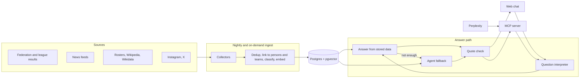

# Klugscheisser Karl

Karl is a research assistant for a Swiss TV sports presenter and journalist who covers Swiss women's ice
hockey. She uses it to prepare broadcasts, commentary and interviews, so she needs facts that are current,
verified and citable: every statement comes with a date and a source link. Karl collects rosters, results,
news, profiles and social media posts every night, and answers questions only from that stored data or from
quotes it has checked against the stored text. It has been in daily use since October 2026.

The user interface is German. Questions can be asked in German or English.

## How it works



1. **Ingestion.** Collectors fetch from public sources: Swiss, IIHF and other league result feeds, about 30
   news RSS feeds, official federation roster pages, Wikipedia and Wikidata, college athletics sites, and the
   players' public Instagram and X accounts. A nightly job refreshes the most important players every night
   and a second group on a weekly rotation. During tournaments a game watcher reads the official game sheets right
   after each final.
2. **Storage.** Each item is stored once in Postgres (one database per project). Ingest removes duplicates,
   links the item to persons and teams with a name matcher and verified social handles, classifies it, and
   stores an embedding in pgvector next to German full-text indexes. Images and reels are described in text
   by a vision model so they become searchable. Facts such as height, club or contract keep every source, and
   conflicting values are shown side by side.
3. **Question interpreter.** An LLM reads the question first and rewrites it into one of a fixed set of
   templates (fact, ranking, age, stats, form, transfers, relationships and so on): names completed, pronouns
   resolved from the chat history, English translated. It only says what the question means; it does not
   answer.
4. **Answer from stored data.** Deterministic code answers the template from the database where it can
   (stats tables, rosters, results). For open questions the model gets the documents of the persons asked
   about and writes sentences that each cite a document id and a verbatim quote. Code then checks every
   citation: the document exists, the quote appears word for word, and a classifier confirms the quote
   supports the sentence. Sentences that fail the check are dropped.
5. **Agent fallback.** When a classifier judges the first answer as not enough, a second stage plans more
   lookups, fetches documents, and tries again, for at most two rounds and within a fixed cost cap per answer.
6. **Two ways in.** A server-rendered web app (search, person, team and event pages, chat with follow-ups)
   and an MCP server with 16 tools that Perplexity calls through a custom connector. Both use the same answer
   path.

More detail: [ARCHITECTURE.md](ARCHITECTURE.md) (components, data flows, settings) and
[docs/sources.md](docs/sources.md) (every data source and its terms of use).

## How quality is kept

- **Fixed chat evaluation.** 65 questions in groups (person facts, team and group questions, stats, news,
  games, relationships, follow-ups, search, edge cases) with the expected content and words that must not appear
  ([tests/fixtures/chat_eval.yaml](tests/fixtures/chat_eval.yaml)). `klugscheisser chat-eval` runs them after
  every change to the answer path and shows which answers got worse since the last run.
  `klugscheisser chat-replay` compares old and new answers to real past questions.
- **Improvement loops with agents.** The MCP gap loop ([docs/mcp-gap-loop.md](docs/mcp-gap-loop.md)) lets a
  stand-in client ask Karl questions through the MCP tools, then an agent reads the answers and traces each
  miss back through source, ingest, database, tool and answer, to tell a data gap from a delivery gap. The UI
  loop ([docs/ui-loop.md](docs/ui-loop.md)) improves the web app on a private preview copy, with a browser
  checker after every round. Both loops judge answers by reading them instead of chasing a single score.
- **Cost caps.** Every paid call goes through one budget: a cap per answer, a cap per agent run, a daily
  cap for all LLM calls, and separate daily and monthly caps for paid scrapers and search APIs. A cost ledger
  in the database records each call.
- **Tests.** More than 1,000 offline tests (no API keys needed) run in CI on every pull request.

## Tech stack

- Python 3.12, managed with [uv](https://docs.astral.sh/uv/)
- PostgreSQL 17 with pgvector and German full-text search, SQLAlchemy, Alembic migrations
- Starlette and uvicorn; htmx for the web pages; the MCP Python SDK (Streamable HTTP) for the connector
- LLM calls through the Anthropic API (Google's API as an alternative and for image/video descriptions and
  embeddings); a hosted classifier and reranker from TypeSafe for labels, ranking and quote checks
- pytest with xdist, GitHub Actions

## Run locally

Requirements: Linux or macOS, uv, Postgres 17 with pgvector (`docker compose up -d` starts one).

```bash
uv sync --all-extras
createdb klugscheisser && createdb klugscheisser_test
cp .env.example .env                 # set MCP_AUTH_TOKEN; add the API keys you have
uv run klugscheisser db upgrade
uv run klugscheisser seed base       # teams, events, rosters, known accounts
uv run klugscheisser seed wikidata   # Swiss players and handle candidates
uv run klugscheisser serve           # web app on http://127.0.0.1:8000/p/eishockey/, MCP on /mcp/eishockey
```

Without API keys the free sources (news feeds, result feeds, Wikidata) still work and the model calls fall
back to simple rules. `uv run klugscheisser features` lists which services are switched on.
`.env.example` documents every setting.

Tests: `uv run pytest -n 4` (offline). Details, including one test database per worktree:
[docs/testing.md](docs/testing.md). Connecting Perplexity or Claude as an MCP client:
[docs/perplexity.md](docs/perplexity.md).

## Status and scope

Live and in daily use since 2026-10-04, through the web app and the Perplexity connector. It is a personal
project built for one user, so the code, the prompts and the docs under `docs/` are partly in German, and
the build plans there record how it grew step by step.

Several data sources have terms that restrict automated or commercial reuse (see
[docs/sources.md](docs/sources.md)). Check them before running the collectors for anything beyond personal
research.
